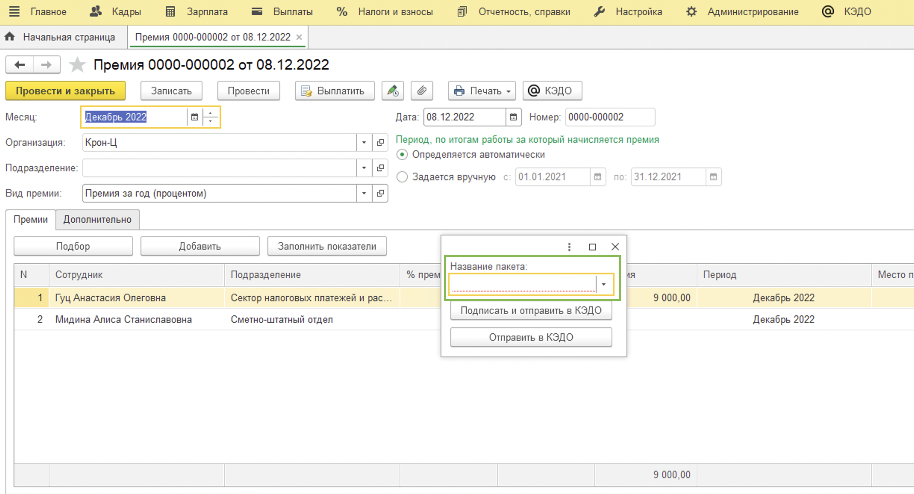
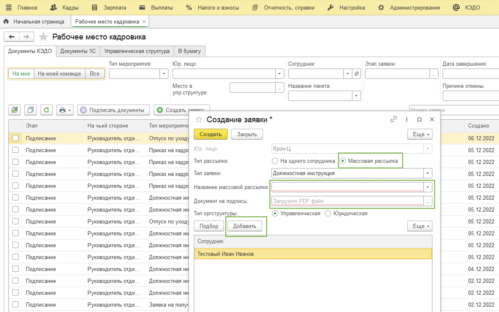
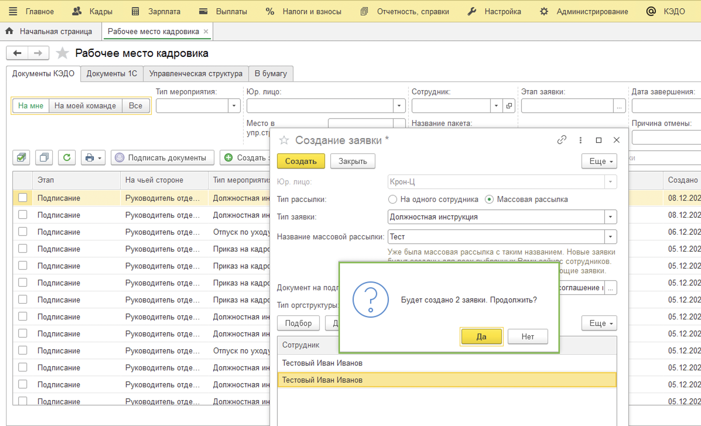

У Отдела кадров есть возможность создавать пакетные заявки – одинаковые заявки на несколько сотрудников. 

Пример: Рассылка должностной инструкции на N новых сотрудников.

## Отправка групповых документов

Возможно сделать массовую рассылку из следующих 1С документов:

1. Изменение графика работы списком (Приказ об изменении графика работы).
2. Кадровый перевод списком (Приказ о перевода (Т-5а)).
3. Работа в выходные и праздничные дни​​​​​​​ (Приказ о работе в выходной (праздничный день)).
4. График отпусков (Выписка из графика отпусков).
5. Премия (Приказ на премию Т-11).

При этом групповой документ (например, приказ на премию сразу на группу сотрудников) будет разделён и каждый сотрудник из списка получит заявку только со своей частью и персональной информацией. 

Для отправки группового документа в КЭДО убедитесь, что у вас есть соответсвующий бизнес-процесс. 

Затем нажмите кнопку **КЭДО** и задайте название пакета. 

<info>
По названию пакета вы сможете отфильтровать отправленные заявки и отследить статус подписания/ознакомления всеми сотрудниками.
Если несколько раз задать одинаковое название пакета, то все заявки объединятся в один фильтр
</info>

## Отправка одного документа

Возможно сделать массовую рассылку одного и того же документа сразу на группу сотрудников. Функциональная возможность подойдёт для отправки таких документов, как должностная инструкция, когда требуется направить один документ сразу нескольким сотрудникам и не создавать заявку на каждого отдельно. 

Перейдите в **1С** → **КЭДО** → **Рабочее место кадровика**.

Нажмите кнопку **Создать заявку**.

Далее:

- Проверьте поле Юр. лицо;

- Выберите тип рассылки **Массовая рассылка**;

- Тип заявки выберите из выпадающего списка;

- Укажите название массовой рассылки;

- Загрузите документ (если требуется);

- Выберите тип оргструктуры;

- Добавьте сотрудников.

<info>
Если выбрать массовую рассылку и добавить всего одного сотрудника, то создастся обычная заявка, как если создавать её на одного сотрудника
</info>

Подтвердите отправку заявок.

В нижней части 1С появится системное оповещение об успешном создании заявок. Процесс завершён.

При создании заявки с другим типом заявки и с массовой рассылкой может быть представлен иной список атрибутов для заполнения. 

Доступные типы атрибутов:

- дата;
- текст;
- выбор из заданных вариантов (без зависимостей);
- файлы — с возможностью одиночного или множественного добавления.