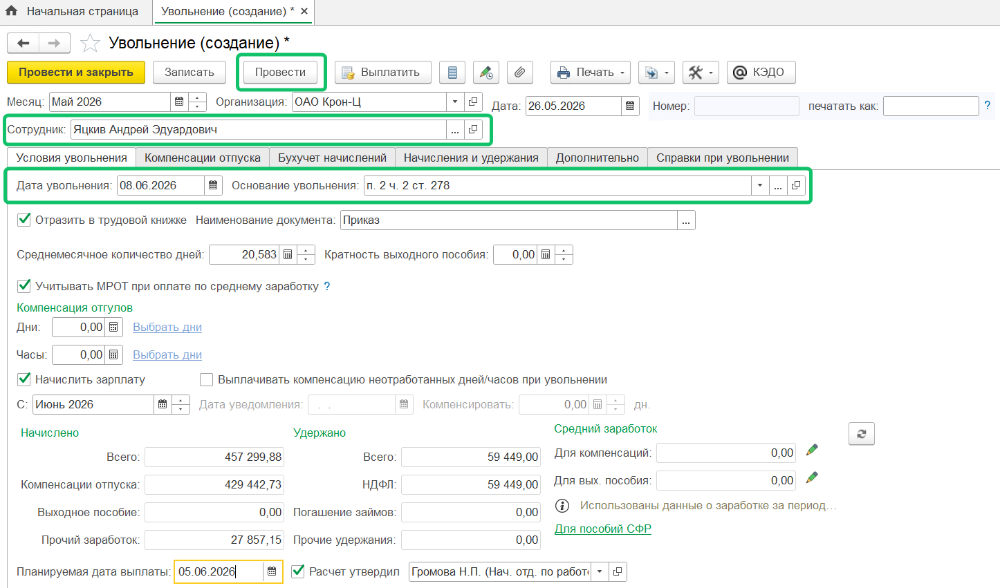
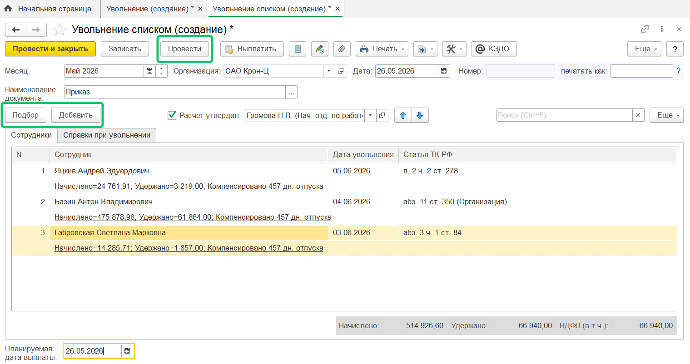

Чтобы уволить сотрудников в 1С:ЗУП, необходимо заполнить и провести документы «Увольнение» или «Увольнение списком».

Выполнить действия, связанные с увольнением, можно в одном из разделов:

- **Кадры → Приемы, переводы, увольнения** → кнопка **Создать** → **Увольнение (Увольнение списком)**;
- **Кадры → Увольнения (Увольнения списком)** → кнопка **Создать**;
- **Кадры → Сотрудники** → карточка сотрудника → кнопка **Оформить документ** → пункт **Кадры** → пункт **Увольнение**.

<warn>

Не рекомендуется отключать сотрудника от КЭДО сразу же после увольнения.

Если кадровый специалист провёл документ «Увольнение» и сразу после этого, до 23:59 того же дня, в разделе **Подключение сотрудников** убрал флажок в столбце **Подключить**, то данные об увольнении не будут переданы из 1С в КЭДО, и статус «Уволен» не будет присвоен сотруднику (в Профиле пользователя не будет отметки об увольнении).

</warn>

## **Документ «Увольнение»**

Кадровый специалист заполняет документ «Увольнение» на основании сведений о сотруднике и его доходах.

На вкладке **Условия увольнения** заполните обязательные поля:

- **Организация**. Проверьте, что выбрана верная организация, если к 1С подключено несколько компаний.
- **Сотрудник**. Выберите ФИО из справочника.
- **Дата увольнения**. Соответствует дате прекращения трудового договора (указана в заявлении сотрудника, соглашении, приказе).
- **Основание увольнения**. Выберите из списка статью трудового кодекса (собственное желание, сокращение и т. д.).

Большая часть реквизитов заполняется автоматически. При необходимости внесите изменения: проставьте галочки, уточните виды удержаний, пособий, прочие параметры.

Также заполните необходимые сведения на вкладках **Компенсация отпуска**, **Начисления и удержания**, **Дополнительно**.

После заполнения всех необходимых значений нажмите кнопку **Провести**.

## Документ «Увольнение списком»

Документ «Увольнение списком» позволяет оформить увольнение для группы сотрудников. Нажмите кнопку **Подбор** или **Добавить**, чтобы выбрать из справочника сотрудников, которых нужно уволить. При этом для каждого создается свой документ, который откроется, если нажать на строку списка.

После заполнения всех необходимых значений по каждому сотруднику в списке нажмите кнопку **Провести**.

Увольнение выбранных сотрудников производится по одному приказу (с одним номером и датой) и в одном месяце расчета, а даты увольнения и причины могут быть разными.

Документ «Увольнение списком» удобно использовать при массовых увольнениях в одном месяце, сокращении штата, ликвидации.

## Использование лицензий КЭДО

Исходящие пакеты, содержащие данные об увольнении сотрудника, передаются из 1С в КЭДО один раз в сутки (после 0:00). 

Лицензия КЭДО освобождается после наступления даты увольнения сотрудника. Если кадровый специалист отменил проведение документа «Увольнение», то сотрудник снова использует лицензию.

Информация о количестве используемых и доступных лицензий в компании доступна в разделе **КЭДО → Подключение сотрудников**.

## Повторное проведение документа «Увольнение» 

Данные об увольнении сотрудника передаются в КЭДО на протяжении 7 дней по всем проведенным документам.

Если кадровый специалист отменил проведение документа «Увольнение», то сотрудник становится снова активным в КЭДО после синхронизации данных по сотрудникам из 1С. 

Если документ «Увольнение» первично или повторно провели по истечении 7-дневного срока от даты увольнения в документе, то данные об увольнении уже не будут переданы в КЭДО.

**Пример.** 1 ноября кадровый специалист провёл документ «Увольнение» по сотруднику с датой увольнения 2 ноября. На следующий день (2 ноября) статус «Уволен» был присвоен сотруднику в КЭДО и кадровый специалист отменил проведение документа «Увольнение» с датой увольнения 2 ноября. На следующий день (3 ноября) сотруднику был присвоен статус «Активен» в КЭДО. 

Через 6 дней (9 ноября) кадровый специалист повторно провёл документ «Увольнение» с датой увольнения 2 ноября, но в КЭДО для сотрудника остался статус «Активен» — когда проводят увольнение с датой на 7 дней раньше, чем сегодня, 1С не отправляет исходящий пакет по этому сотруднику.

