Конструктор бизнес-процессов (или процессов) позволяет Администратору компании или аккаунта создать новый тип заявки и настроить маршрут его этапов в визуальном интерфейсе — без обращения в поддержку. 

Маршрут отображается схемой: этапы, развилки, параллельные этапы, возвраты на доработку. Настройки этапа задаются в боковой панели: выберите этап на схеме — и справа откроются его параметры (исполнитель, действие, атрибуты и другие).

## **Кто может пользоваться**

Создавать и редактировать процессы в конструкторе могут пользователи с ролью **Администратор**:

* **Администратор** (в компании) — для компаний, в которых у пользователя есть роль Администратор;  
* **Администратор в аккаунте** — для всех компаний аккаунта. Если пользователь — Администратор нескольких аккаунтов, то он может создавать процессы во всех компаниях этих аккаунтов.

## **Создание бизнес-процесса**

### **Как открыть**

1. Перейдите в раздел **Сервисы компании → Настройки → Типы заявок**.  
2. Нажмите кнопку **Создать тип**.

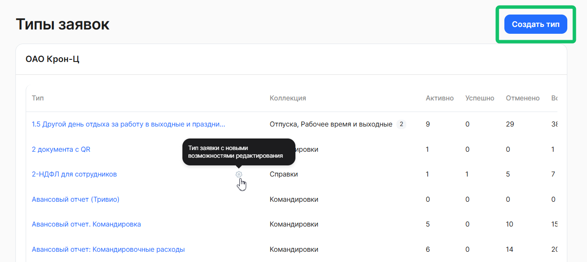

3. Откроется страница **Создание этапов заявки**: слева — схема процесса, справа — панель настроек.  

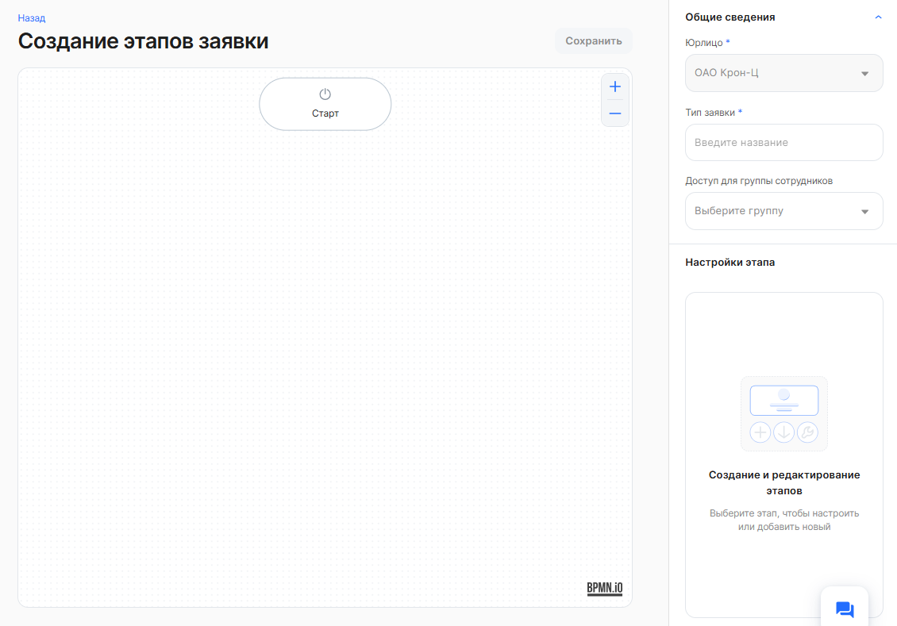

### **Общие сведения**

В панели настроек, в блоке **Общие сведения** заполните:

* **Юрлицо** — компания, для которой создаётся тип заявки. Доступны компании, где у вас есть роль Администратор. Выбрать можно одну компанию.   
* **Тип заявки** — название процесса. Оно должно быть уникальным в компании: при совпадении появится ошибка «Тип заявки с таким названием уже существует».  
* **Доступ для группы сотрудников** — ограничивает, каким группам сотрудников доступен тип заявки. Можно выбрать одну группу, указывать её необязательно. Актуально только для компаний, где сотрудники и процессы разделяются по группам.   
  * **Группа типов** — появляется, если для типа заявки указана группа сотрудников.   
    Название типа заявки можно сделать уникальным (например, в конце названия добавить значение выбранной группы сотрудников), а название группы типов оставить общим — в интерфейсах будет использоваться общее название, но для каждой группы сотрудников подставляться нужный тип заявки.  
    Пример: Типы заявки: Отпуск (склад), Отпуск (офис). Группа типов: Отпуск.

После сохранения типа заявки поля **Юрлицо** и **Тип заявки** станут недоступны для редактирования.  
 
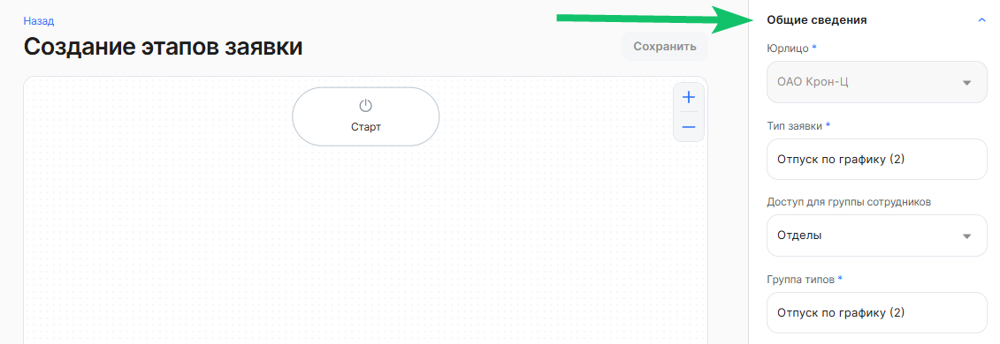

### **Как построить маршрут**

Первый этап **Старт** уже добавлен на схему: его нельзя удалить, и второго старта быть не может.  

Чтобы добавить элементы, выберите этап на схеме и в меню **Что добавить** нажмите нужный пункт:
* **Новый этап** — добавляет обычный этап после выбранного.  
* **Развилка** — добавляет этап проверки, по результату которого заявка уходит в одну из двух веток: основную (действие «Проверка») или альтернативную (действие «Отклонено»).  
* **Параллельный этап** — добавляет этап, который выполняется одновременно с выбранным.   
* **Этап финиш** — добавляет завершающий этап. Доступен, только если у выбранного этапа ещё нет следующего этапа.  
* **Возврат на доработку** — нажмите пункт, затем выберите этап, на который заявка должна возвращаться. Вернуть можно на обычный этап, на один из параллельных этапов. Нельзя вернуть на старт или финиш.  
* **Удалить возврат на доработку** — удаляет настроенный возврат.

Чтобы удалить этап, нажмите значок корзины в меню этапа. Каждая ветка процесса должна заканчиваться этапом финиша.  

Пункты меню для выбранного этапа **Старт**:

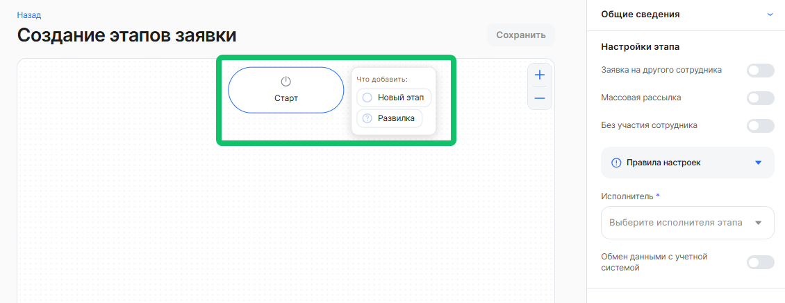

Пункты меню для выбранного обычного этапа:  

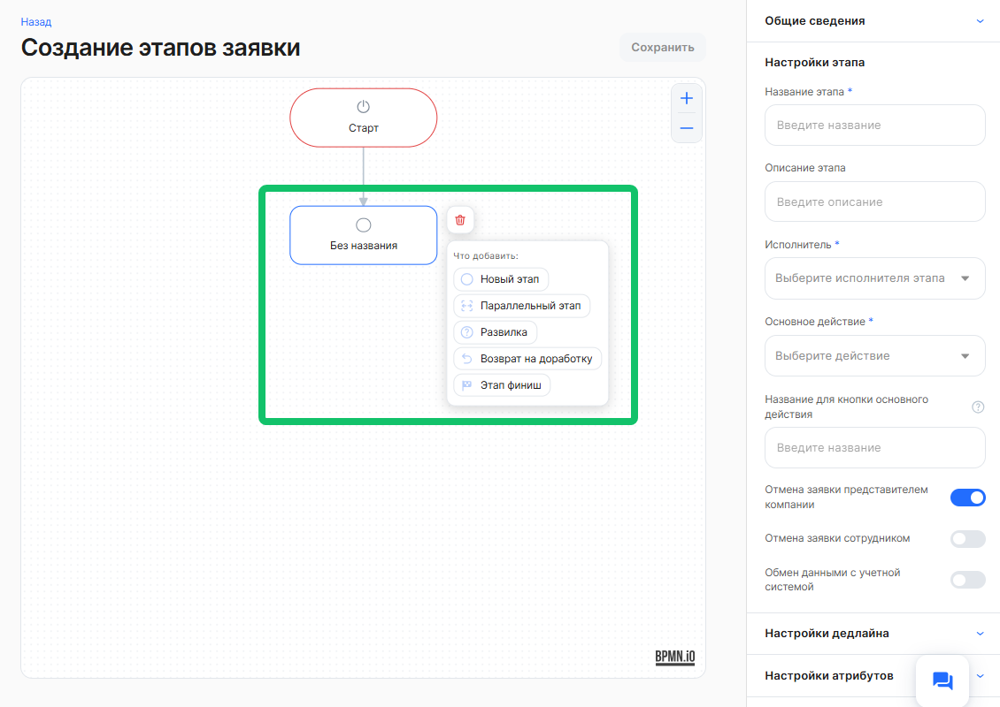

## **Настройки этапа**

Выберите этап на схеме — справа откроется панель **Настройки этапа**. Если ничего не выбрано, в панели отображается подсказка «Выберите этап, чтобы настроить или добавить новый».

### **Старт**

Для стартового этапа доступны переключатели:

* **Заявка на другого сотрудника** — позволяет сотруднику создать заявку на другого сотрудника.  
* **Массовая рассылка** — позволяет создать одинаковые заявки сразу нескольким сотрудникам.  
* **Без участия сотрудника** — заявка создаётся без сотрудника, участвовать могут только пользователи с каким-то ролями со стороны компании.

В блоке **Правила настроек** указаны ограничения:
* если включена настройка «Без участия сотрудника», заявку может стартовать только представитель компании, а на этапах нельзя назначить сотрудника исполнителем;  
* если включена настройка «Заявка на другого сотрудника», заявку может стартовать только сотрудник;  
* «Без участия сотрудника» нельзя включить вместе с «Заявкой на другого сотрудника» и «Массовой рассылкой».

Также на старте задаются: 
* **Исполнитель** — роли, которые могут создавать заявку;  
* **Обмен данными с учетной системой** — создаёт задачу на обмен данными с учетной системой, это может быть не только 1С. Доступно, если для компании настроена интеграция.

### **Обычный этап**

Обычный этап — это любой этап, кроме **Старт** и **Финиш**. Для обычного этапа заполните:
* **Название этапа** — отображается на схеме и в заявке.  
* **Описание этапа** — пояснение для сотрудников, что нужно сделать на этапе.  
* **Исполнитель** — можно выбрать несколько ролей.

Доступные варианты в поле **Исполнитель** и дополнительные поля:

| Исполнитель | Что указать после выбора исполнителя |
| ----- | ----- |
| **Сотрудник** | Дополнительных полей нет |
| **Представитель компании** | Выберите одну или несколько ролей в поле **Представители компании** |
| **Руководитель** | **Тип оргструктуры**: Управленческий, Юридический или Функциональный. **Уровень по иерархии**: для управленческой и юридической — до 10, для функциональной — до 20 |
| **Ассистент** | **Уровень по иерархии** — до 10 |
| **Создатель заявки** | Исполнитель, который создал заявку. Используется на следующих этапах, когда действие должен выполнить автор заявки.  Случаи, когда можно выбрать «Создателя заявки»: 1\. Заявка на другого сотрудника (на старте включён переключатель «Заявка на другого сотрудника») — на последующих этапах, где действие должен выполнить инициатор (например, руководитель, создавший заявку на сотрудника), указывается исполнитель «Создатель заявки». 2\. Заявка без участия сотрудника / заявка, стартующая от руководителя — на следующих этапах, где требуются действия от инициатора, роль «Создатель заявки» указывается именно для него. 3\. Заявка на профиль компетенций — роль указывается после старта от руководителя. |

* **Основное действие** — что должен сделать исполнитель:

| Действие | Что делает | Название кнопки по умолчанию | Использование документа на этапе |
| ----- | ----- | ----- | ----- |
| **Проверка** | Исполнитель проверяет заявку и  переводит ее на следующий этап | «Проверить» | Не используется |
| **Загрузка** | Исполнитель загружает документ | «Загрузить» | Используется.  Название укажите в поле **Название документа**  |
| **Подписание** | Исполнитель подписывает документ.  На первом этапе после старта действие  «Подписание» недоступно | «Подписать» | Используется.  Название укажите в поле **Название документа** |

* **Название для кнопки основного действия** — необязательно. Если оставить поле пустым, будет использовано название по умолчанию.  
* **Тип подписи** — для действия «Подписание»: **ПЭП** (простая электронная подпись), **УНЭП** (усиленная неквалифицированная электронная подпись), **УКЭП** (усиленная квалифицированная электронная подпись). Вариант «УКЭП» недоступен, если среди исполнителей этапа есть сотрудник.  
* **Название документа** — название документа, который сотрудник загружает или подписывает на этапе.

Для **Развилки** дополнительно заполняется **Второе действие** — «Отклонено». Если проверка пройдена, заявка идёт по основной ветке, если отклонена — по альтернативной. По умолчанию кнопка называется «Отклонить», её можно переименовать в поле **Название для кнопки второго действия**.  

Если на этапе настроен возврат на доработку, появляется поле **Название для кнопки возврата**. По умолчанию кнопка называется «На доработку». 

Другие настройки этапа:
* **Отмена заявки представителем компании** — разрешает представителю компании отменить заявку на выделенном этапе;  
* **Отмена заявки сотрудником** — разрешает сотруднику отменить заявку на выделенном этапе;  
* **Обмен данными с учетной системой** — создает задачу на обмен данными с учетной системой компании, это может быть не только 1С. Доступно, если для компании настроена интеграция.

**Пример обычного этапа:**  

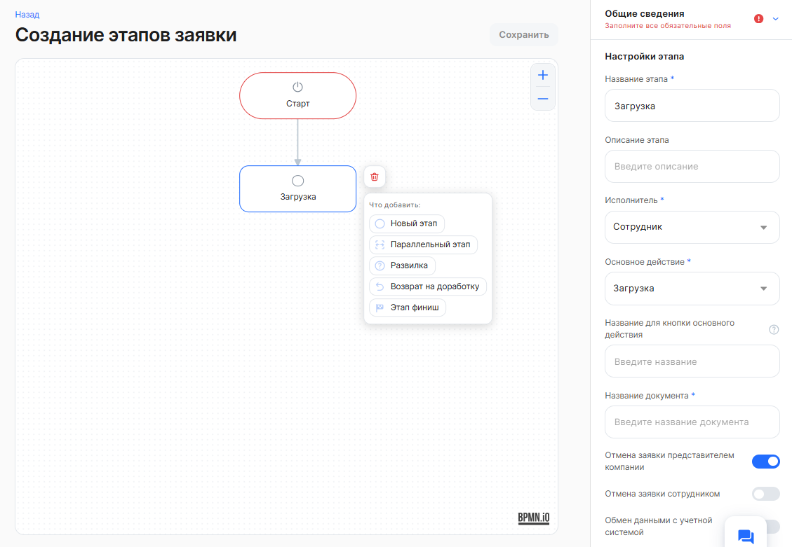

**Пример развилки:**

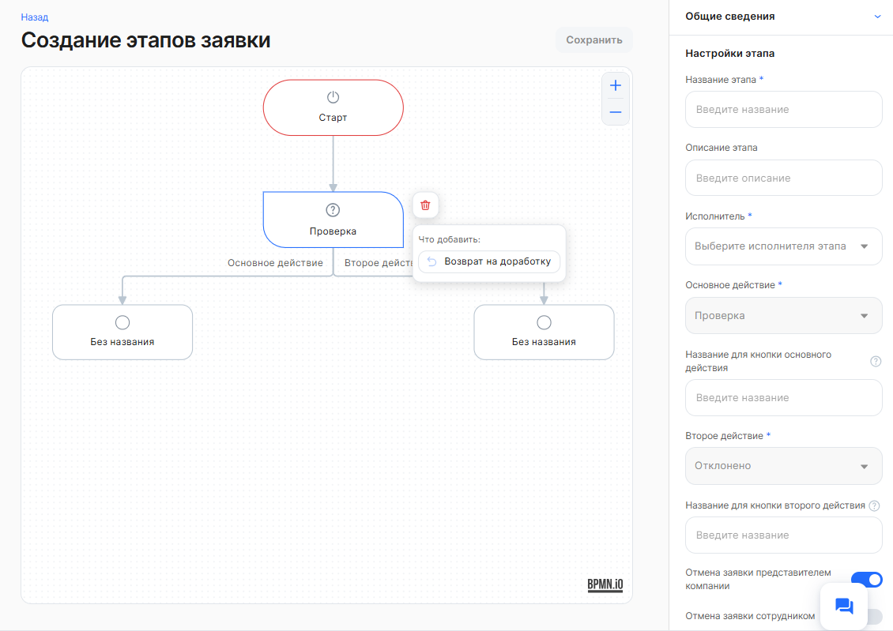

С развилки можно сразу перейти на этап **Финиш**, но для этого сначала добавьте этап **Финиш** после обычного этапа развилки, а потом удалите обычный этап.

**Пример возврата на доработку:**

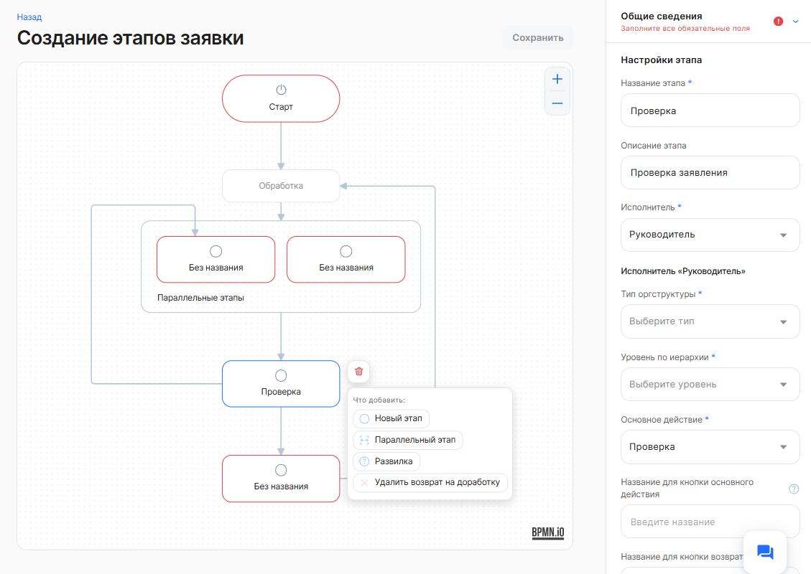

Запрещено добавлять возврат на этап «Старт». 

Для параллельного этапа: если нужно вернутся на один конкретный этап параллельного этапа, то на схеме выберите этот конкретный этап. А если нужно вернуться ко всему параллельному этапу, то все этапы будут назначены повторно.

### **Параллельные этапы**

В блоке **Настройки этапа** для группы параллельных этапов задайте **Условие перехода к следующему этапу**:

* **Успешно закрыты все параллельные этапы** — вариант по умолчанию;  
* **Успешно закрыт хотя бы один этап**.

Между параллельными этапами нельзя настроить прямой переход. 

### **Финиш**

Выберите **Тип финиша**:

* **Успешно завершено** — в заявке будут пройдены все обязательные действия, заявка перейдет в статус **Завершено**.  
* **Отклонено** — заявка перейдет в статус **Отклонено**.

На финише также доступен переключатель **Обмен данными с учетной системой**. В одном процессе может быть несколько финишных этапов — по одному на каждую ветку.  

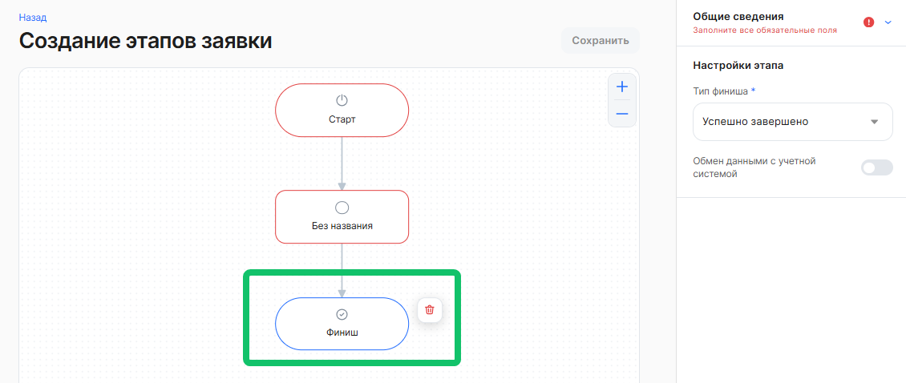

### **Атрибуты этапа**

В блоке **Настройки атрибутов** нажмите кнопку добавления атрибута и заполните:

| Поле | Что указать |
| ----- | ----- |
| **Тип атрибута** | Тип значения атрибута. Доступные типы:  1. **Однострочный текст** — короткий текст в одну строку, до 255 символов.  2. **Многострочный текст** — текст произвольной длины.  3. **Дата** — дата без времени.  4. **Дата и время** — дата и время.  5. **Год** — год.  6. **Выбор из списка** — выбор одного или нескольких значений из заранее заданных вариантов.  7. **Текст со справочником** — текст с выбором значения из справочника компании.  8. **Ссылка** — ссылка на внешний ресурс.  9. **Файл** — возможность загрузить один файл.  10. **Несколько файлов** — возможность загрузить несколько файлов.  11. **Сотрудник** — атрибут, в котором выводятся сотрудники компании, неуволенные.  По умолчанию множественный выбор. |
| **Атрибут** | Подходящий атрибут из списка атрибутов. Список атрибутов общий для всего сервиса: в него попадают атрибуты, которые используются во всех компаниях. |
| **Описание** | Пояснение, что нужно указать в атрибуте. |
| **Обязательный** | Если включено, пользователь не сможет перейти на следующий этап, не заполнив атрибут. |
| **Мультивыбор** | Если включено, можно выбрать несколько значений из списка. |

В конструкторе нельзя создать новый атрибут. Создание новых атрибутов планируется в следующих релизах.  

Особенности:
* для атрибута типа «Выбор из списка» нельзя добавить новый: можно использовать только ранее созданный атрибут с вариантами выбора. Его название и тип в конструкторе не изменяются, но можно изменить описание, обязательность и мультивыбор;  
* для атрибута типа «Текст со справочником» название справочника совпадает с названием атрибута. Если такого справочника в компании нет, он будет создан автоматически как пополняемый;  
* на первом обычном этапе после старта при включённой **Массовой рассылке** доступны только типы: Однострочный текст, Многострочный текст, Дата, Выбор из списка, Файл, Несколько файлов.

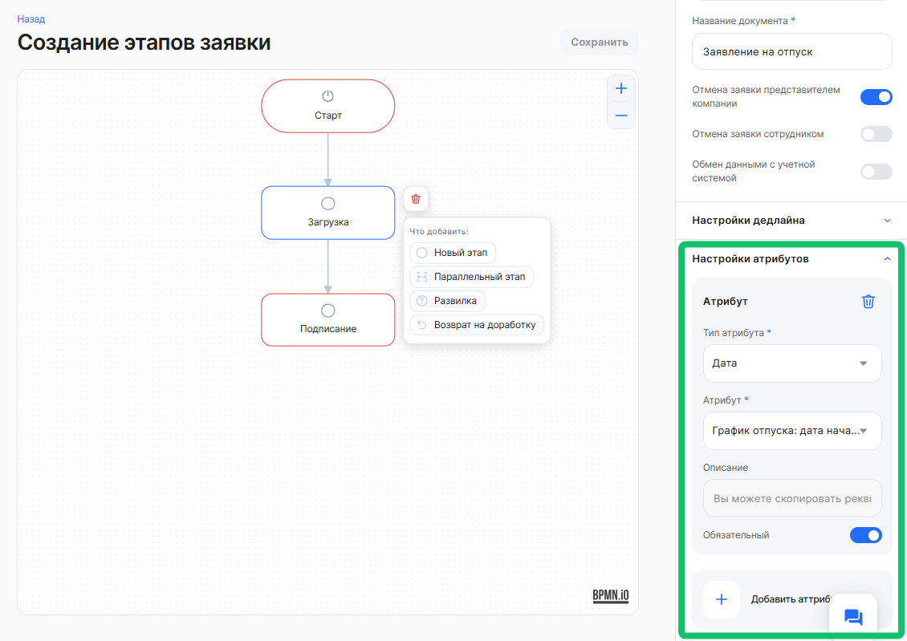

### **Дедлайн этапа**

В блоке **Настройки дедлайна** настройте срок окончания этапа:

* **Без дедлайна** — этап выполняется без ограничения по времени.  
* **Рассчитывать по условиям** — дедлайн рассчитывается по условиям, которые вы задаёте ниже.

Можно задать до трёх условий. Для каждого условия укажите:
* **От чего считаем дедлайн** — событие, от которого отсчитывается срок: например, от момента активации этапа, от момента создания заявки или от атрибута.  
* **Атрибут** — если дедлайн считается от атрибута. Доступны только атрибуты типов «Дата» и «Дата и время», добавленные на этапы процесса.  
* **Единицы измерения** — Рабочий день, Календарный день, Час, Минута.  
* **Количество** — сколько единиц измерения отсчитывается до дедлайна.  
* **Округление до конца дня** — если включено, дедлайн наступает в конце суток, в 23:59. Недоступно для часов и минут; при количестве 0 дней устанавливается автоматически.  
* **Что происходит при наступлении дедлайна** — выберите один из вариантов:

| Вариант | Что произойдёт |
| ----- | ----- |
| **Отмена заявки с опцией перехода в бумагу** | Заявка отменяется и переходит в статус «В бумагу» |
| **Отмена** | Заявка отменяется и переходит в статус «Отменено» |
| **Переход на следующий этап** | Заявка автоматически переходит на следующий этап процесса |

Если условий несколько, выберите **Определение дедлайна с условиями**:

* **Ближайшая дата** — сработает самый ранний срок из рассчитанных;  
* **Поздняя дата** — сработает самый поздний срок из рассчитанных.

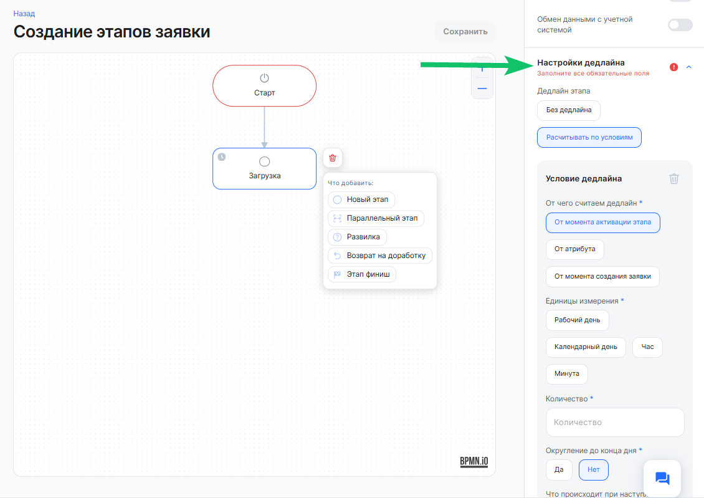

## **Сохранение процесса**

Кнопка **Сохранить** активна, только если процесс полностью настроен и в него внесены изменения. Незаполненные этапы выделяются на схеме красным, а в панели отображается сообщение «Заполните все обязательные поля».  

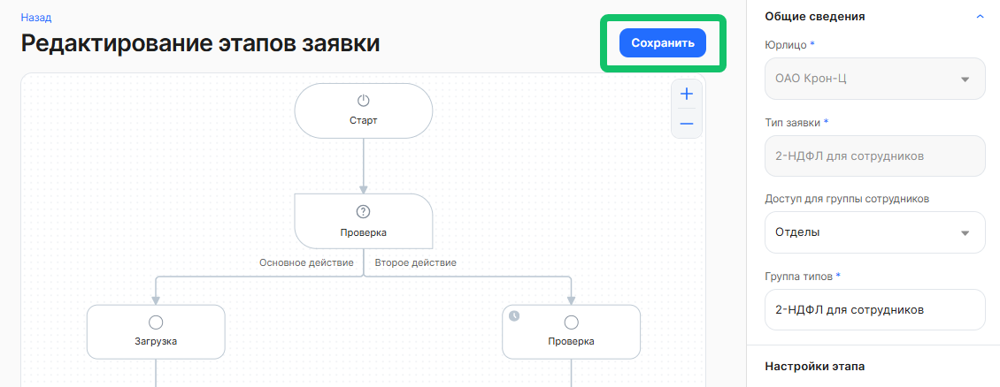

Проверяются:
* уникальность названия типа заявки;  
* наличие названия, исполнителя и хотя бы одного действия на каждом этапе (кроме служебных этапов и финиша);  
* заполненность обязательных полей атрибутов и дедлайнов;  
* наличие названия документа для действий «Загрузка» и «Подписание»;  
* завершение каждой ветки финишным этапом;  
* отсутствие прямых переходов между параллельными этапами;  
* совместимость настроек старта с указанным исполнителем.

Если проверки не пройдены, процесс не создаётся и не обновляется. После сохранения изменения вступают в силу.

Ограничение на частоту сохранений действует на компанию, а не на отдельный процесс: не более 3 операций в минуту и не более 15 в час. При превышении появится ошибка, изменения не применяются.

## **Редактирование процесса**

Перейдите в раздел **Настройки** → **Бизнес-процессы** → **Типы заявок**. Откройте тип заявки с новыми возможностями редактирования — он обозначен шестеренкой.  

Если значка шестеренки у типа заявки нет — новый конструктор пока не используется, так как в процессе есть функционал, которого пока нет в конструкторе.   

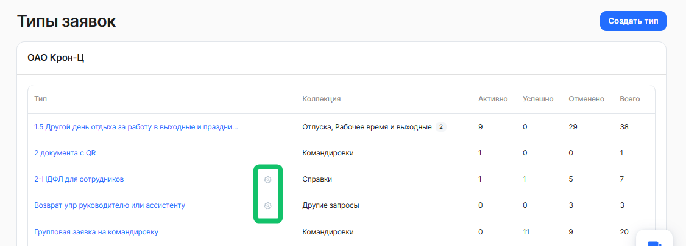 

Откройте тип заявки и найдите блок **Этапы заявки**. В зависимости от процесса в блоке отображается одна из подписей:

* **Доступны новые возможности редактирования** — нажмите **Редактировать**, чтобы открыть конструктор. В нём доступны те же настройки, что и при создании. Юрлицо и название типа заявки изменить нельзя, остальные настройки — можно.  
* **Новый инструмент для редактирования бизнес-процесса пока не доступен** — процесс открывается в прежнем интерфейсе. В нём можно изменить только дедлайны этапов, группу представителей компании и тип оргструктуры.

Изменения применяются только по кнопке **Сохранить**. Если обновить страницу без сохранения, изменения будут потеряны.  

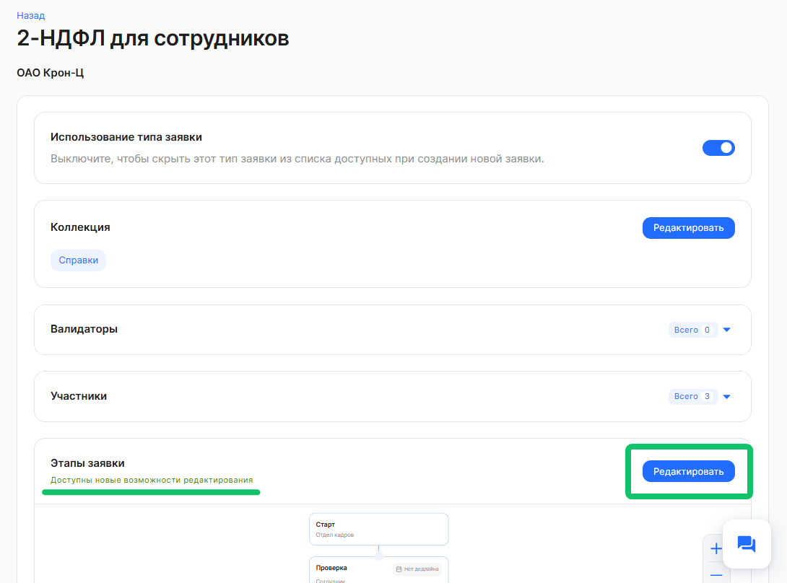

## **Ограничения**

* Созданный процесс нельзя удалить. Чтобы он не отображался сотрудникам, выключите **Использование типа заявки** на странице типа заявки.  
* После создания нельзя изменить юрлицо и название типа заявки. Остальные настройки можно изменить при редактировании процесса.  
* В конструкторе нельзя создать новые атрибуты, новые группы сотрудников и валидаторы.  
* Перемещение этапов по холсту не предусмотрено: этапы добавляются и удаляются через меню этапа.  
* Если процесс содержит настройки, которых нет в конструкторе (например, валидаторы, ники, мета-атрибуты, рассчитываемые атрибуты, нестандартные действия), он открывается в прежнем интерфейсе редактирования.