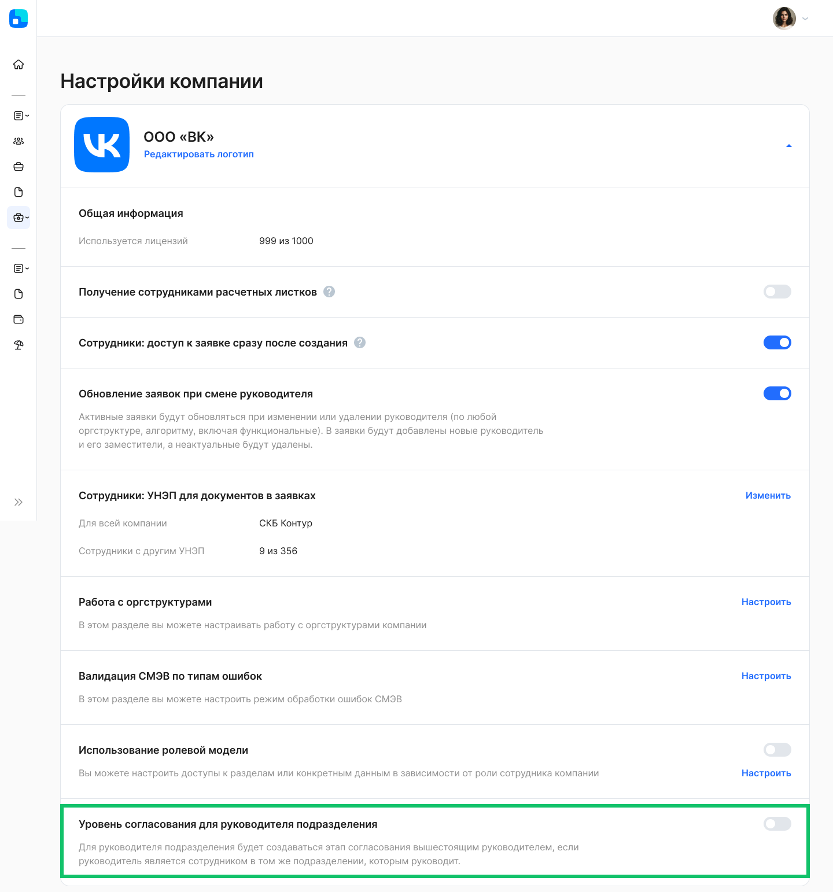

При включенной настройке **Уровень согласования для руководителя подразделения** (в разделе **Настройки компании**) для руководителя подразделения будет создаваться этап согласования вышестоящим руководителем, если руководитель является сотрудником в том же подразделении, которым руководит.

Если включена настройка **Уровень согласования для руководителя подразделения**, то:
1. По управленческой структуре: если пользователь является одновременно и руководителем, и сотрудником в подразделении, то заявку сотрудника будет согласовывать вышестоящий руководитель по структуре. Этап пропускается только в случае, если на следующем уровне нет работающего руководителя, например, выше нет подразделения.
Руководитель подразделения не обязан быть сотрудником вышестоящего подразделения. Если он там числится как сотрудник, то его заявку согласует руководитель этого подразделения и без включенной настройки.

2. По юридической структуре: если пользователь является одновременно и руководителем, и сотрудником в подразделении, то заявку сотрудника будет согласовывать вышестоящий руководитель по структуре (этап согласования не будет пропущен).

