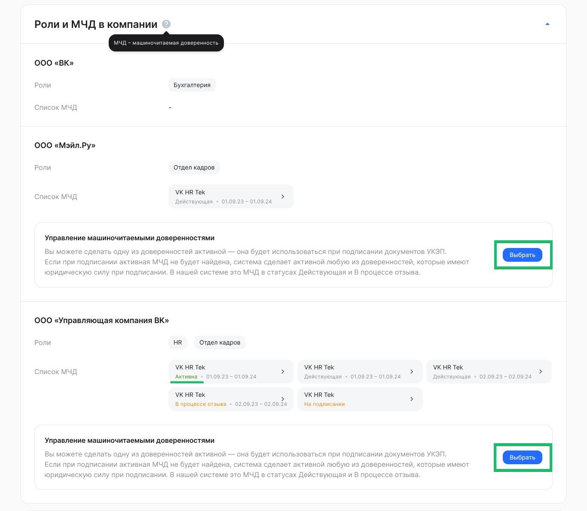
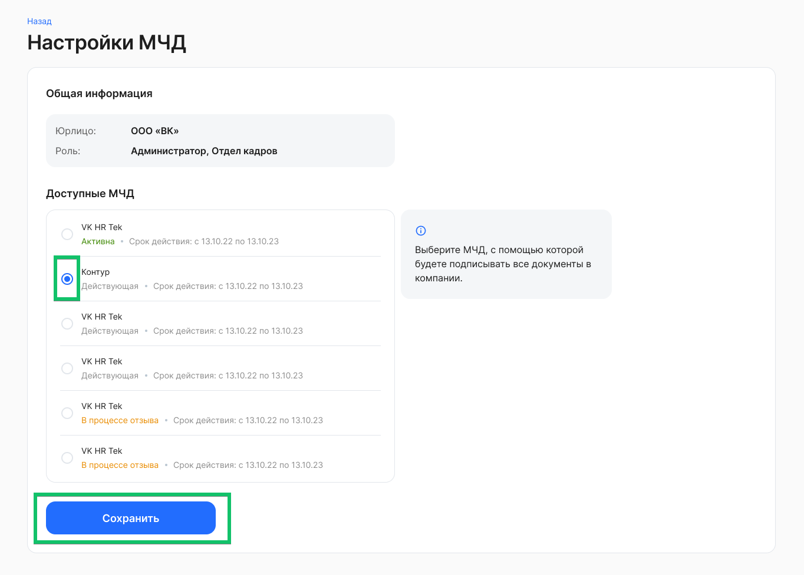

Сотрудники могут подписывать документы, используя только одну МЧД (активную), даже если у него их несколько. Активной может быть только МЧД в состоянии ***Действующая*** или ***В процессе отзыва***.

<warn>

Следите за сроком действия МЧД.

На данный момент система блокирует подписание документов с использованием неактуальной МЧД с истекшим сроком действия.

Система может направлять уведомления о том, что у доверенности истекает срок действия. Подробнее о подключении кастомных уведомлений см. в [статье](/ru/hr/notifications#kastomnye_uvedomleniya)

</warn>

Сотрудник может сам определить, какую МЧД назначить активной. Для этого необходимо:

1\. Перейти в **Профиль** пользователя.

2\. В блоке **Роли и МЧД в компании** выбрать или сменить активную МЧД по нажатию кнопки **Выбрать**.

3\. В **Настройках МЧД** отметьте одну МЧД, с помощью которой будут подписываться все документы в компании. Сохраните выбор.

Если сотрудник не назначил активную МЧД, то при подписании документа в заявке сервис ищет действующую МЧД, помечает её «активной» и использует в следующих подписаниях.