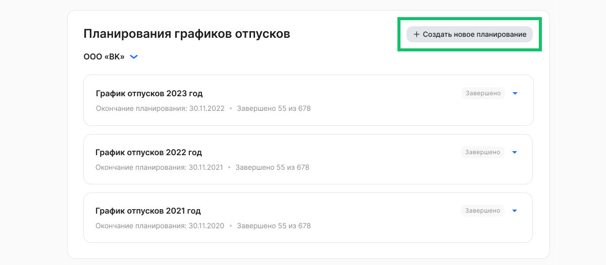
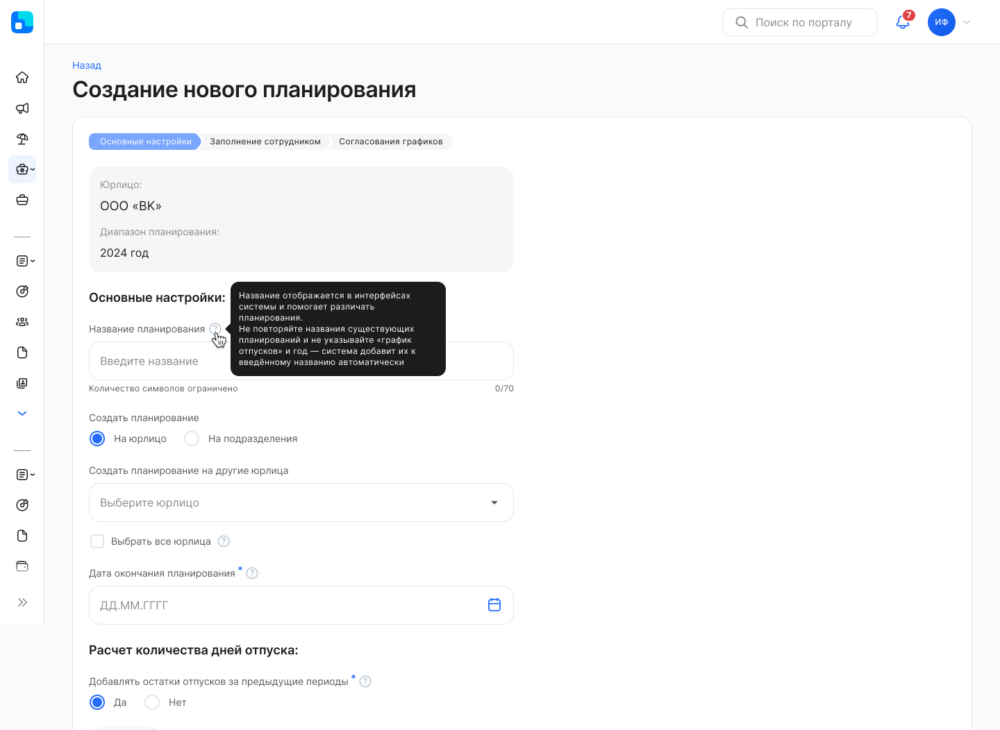
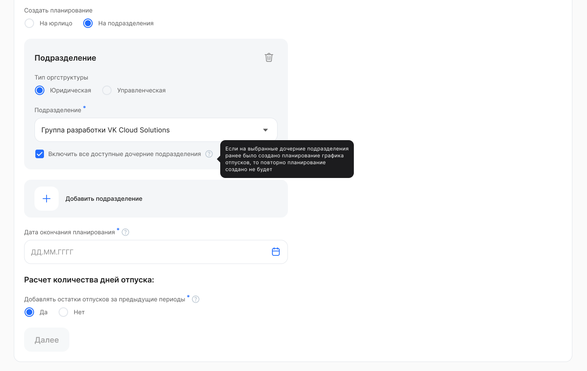
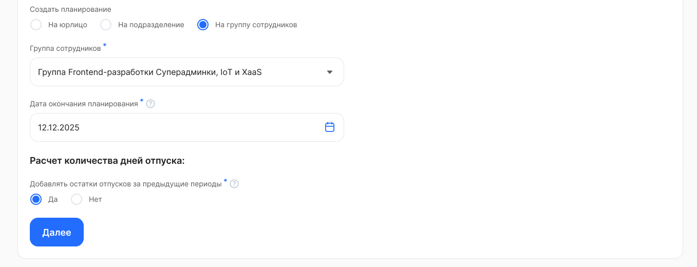
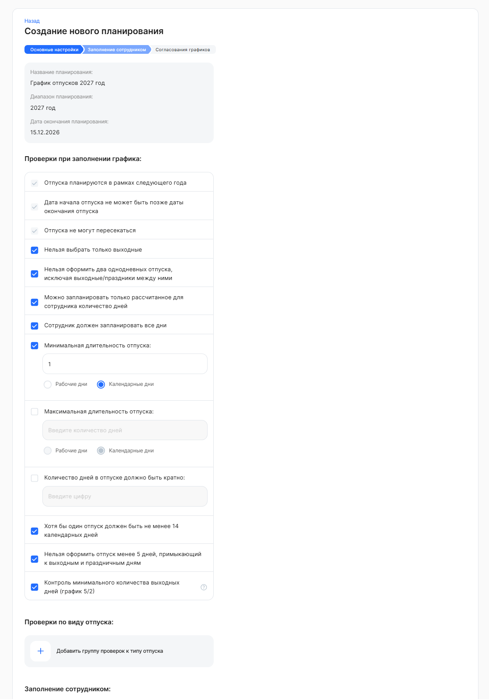
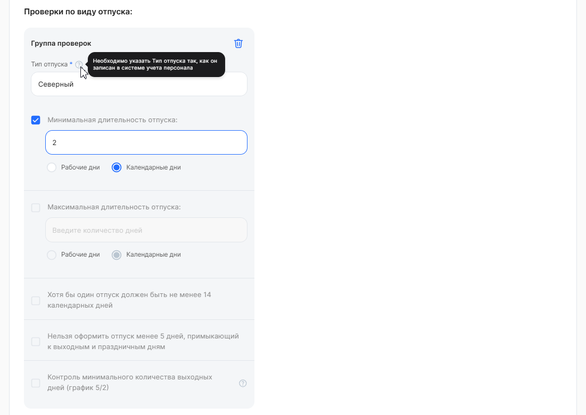
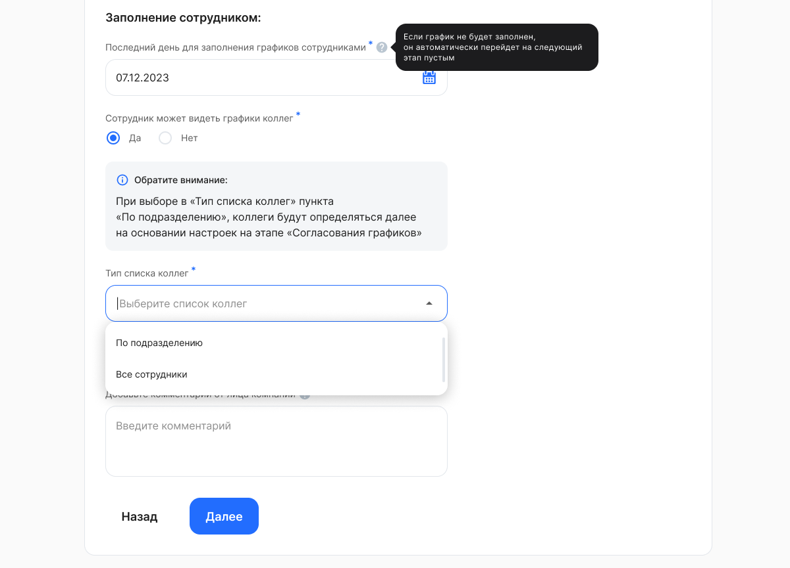
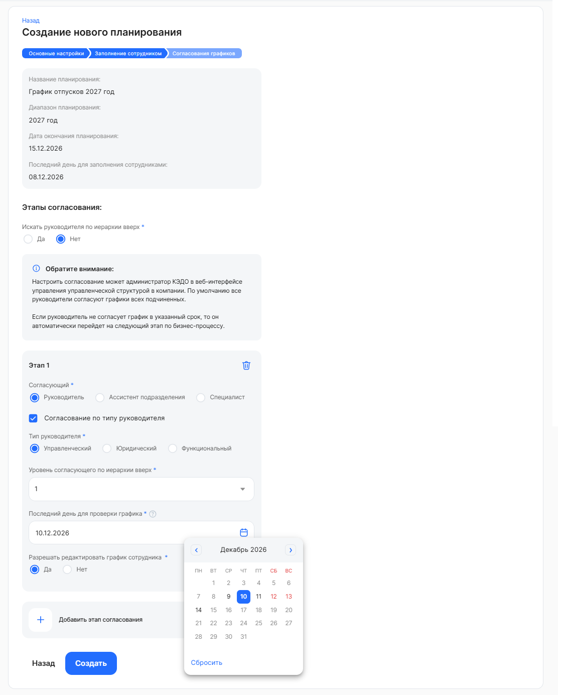
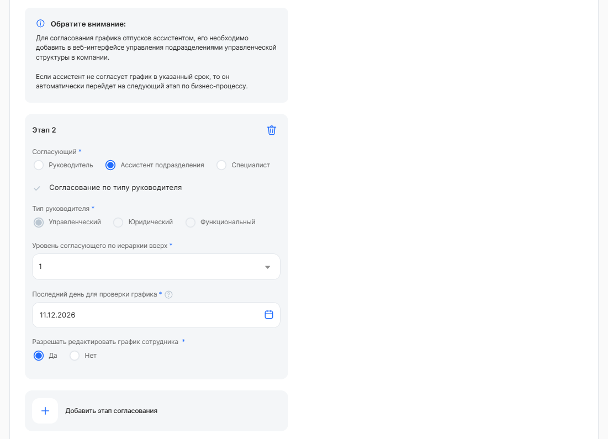
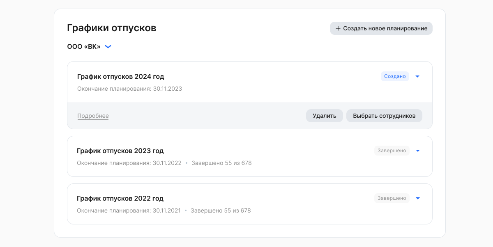

Для создания планирования графиков отпусков в **Сервисах компании → Настройки → Графики отпусков** нажмите кнопку **Создать новое планирование**.

Можно создать только одно планирование на следующий год.

## Основные настройки
В форме **Создание нового планирования** заполните:

1. **Основные настройки**:
- **Название планирования**. Укажите название, например «Название Фабрики» или «Центральный офис». Название будет отражаться в формате «График отпусков + год + Название», если название не задано (так как атрибут опциональный), остаётся стандартное название «График отпусков + год» (возможен такой сценарий, что название задается выборочно, некоторым планированиям дается название, некоторым — нет). Поле с названием необязательное, можно ввести до 70 символов, спецсимволы <, > и " запрещены.
- **Создать планирование**. Выберите один из вариантов: **На юрлицо** или **На подразделение**. Для компаний, у которых в кадровой системе есть группы (категории), присваиваемые сотрудникам, доступен вариант **На группу сотрудников**. 

### Планирование на юрлицо

- **Создать планирование**. Выберите вариант **На юрлицо**. 
- **Создать планирование на другие юрлица**. Для компании, в которой несколько юрлиц объединены в один аккаунт, можно выбрать несколько или все компании аккаунта в списке **Создать планирование в других юрлицах аккаунта**.  
Обратите внимание, что выбрать сотрудников и запустить создание задач для них нужно будет вручную в каждой компании отдельно.

### Планирование на подразделение

Возможность создавать планирование графика отпусков по подразделениям в рамках одного юридического лица. 

- **Создать планирование**. Выберите вариант **На подразделение**. 
- **Тип оргструктуры**. Выберите один вариант в соответствии с оргструктурой компании: **Юридическая** или **Управленческая**.
- **Подразделение**. Выберите одно доступное подразделение из списка. Запрещено добавлять подразделение, для которого уже было создано планирование. 
- **Включить все доступные дочерние подразделения**. Если требуется создать планирование на дочерние подразделения, которые относятся к выше выбранному подразделению, активируйте опцию. Для ранее созданных планирований в дочерних подразделениях не будет создано повторное планирование.
- кнопка **Добавить подразделение**. Нажмите на кнопку, если требуется создать планирование на еще одно подразделение. После добавления второго подразделения появится возможность удалить блоки с подразделениями.  

### Планирование на группу сотрудников

Применимо для компаний, у которых в кадровой системе есть группы (категории), присваиваемые сотрудникам. Подробнее о том, как распределить сотрудников по группам в 1С, см. в [статье](/ru/1C/user/employees/groups).

- **Создать планирование**. Выберите вариант **На группу сотрудников**.
- **Группа сотрудников**. Выберите одну доступную группу из списка. 

 

- **Дата окончания планирования**. Указанная дата  будет использована для расчета дедлайнов этапов планирования.
- **Указать пороговый процент запланированных отпусков в месяц**. Поле доступно, если в настройках компании/аккаунта включена опция **Процент запланированных отпусков по подразделению**. Выберите вариант *Да*, если хотите рассчитать, какая доля годовых отпусков в подразделении приходится на каждый месяц, а также посмотреть, где эта доля выше допустимого значения, заданного при запуске планирования, иначе выберите *Нет.* 
    - **Пороговое значение**. Появляется, если выбран вариант *Да*. Укажите пороговый процент для сравнения с рассчитанным: необязательно целое число, одно на всё планирование.
2. **Расчет количества дней отпуска**:
- **Добавлять остатки отпусков за предыдущие периоды**. Выберите вариант *Да*, если хотите просматривать неиспользованные дни отпуска сотрудников за прошедшие годы, иначе выберите *Нет.* Дни отпуска, запланированные до конца года, будут вычитаться из суммы остатков.

Нажмите кнопку **Далее**.

## Заполнение сотрудником
В блоке **Проверки при заполнении графика** кадровый специалист может задать правила проверки, которые будут срабатывать при заполнении графика сотрудниками.

Обязательные правила проверки заполнения:

- Отпуска планируются в рамках следующего года.
- Дата начала отпуска не может быть позже даты окончания отпуска.
- Отпуска не могут пересекаться.

По умолчанию установлены проверки, которые можно убрать или скорректировать:
- Нельзя выбрать только выходные.
- Нельзя оформить два однодневных отпуска, исключая выходные/праздники между ними.
- Можно запланировать только рассчитанное для сотрудника количество дней, т.е. нельзя запланировать больше дней отпуска, чем доступно сотруднику.
- Сотрудник должен запланировать все дни, что ему доступны, но может дополнительно указать и больше дней.
- Хотя бы один отпуск должен быть не менее 14 календарных дней.
- Нельзя оформить отпуск менее 5 дней, примыкающий к выходным и праздничным дням.
- Контроль минимального количества выходных дней (график 5/2). 
- Минимальная длительность отпуска. Введите минимальное число рабочих или календарных дней, которое сотрудник сможет указать при планировании графика.

Другие опциональные проверки:

- Максимальная длительность отпуска. 
  Введите максимальное число рабочих или календарных дней, которое сотрудник сможет указать при планировании графика.
- Количество дней в отпуске должно быть кратно. 
  Введите цифру, которой должно быть кратно количество дней в одном отпуске. 

В блоке **Проверки по виду отпуска** выполните действия:
- нажмите кнопку **Добавить группу проверок к типу отпуску**, чтобы сотрудник смог заполнить количество дней не только по основному отпуску, но и по другим видам, если такие ему полагаются.
- заполните **Тип отпуска**. Укажите вид отпуска так, как он записан в учетной системе компании.
- выберите опциональные проверки:
    - Минимальная длительность отпуска. Введите минимальное число рабочих или календарных дней, которое сотрудник сможет указать при планировании графика.
    - Максимальная длительность отпуска. Введите максимальное число рабочих или календарных дней, которое сотрудник сможет указать при планировании графика.
    - Хотя бы один отпуск должен быть не менее 14 календарных дней.
    - Нельзя оформить отпуск менее 5 дней, примыкающий к выходным и праздничным дням.
    - Контроль минимального количества выходных дней (график 5/2). 

В блоке **Заполнение сотрудником** заполните поля:

- **Последний день для заполнения графиков сотрудниками**. Укажите дату, до которой сотрудник должен заполнить график отпусков. Дата заполнения сотрудником не должна совпадать с датой окончания планирования, так как ещё будут этапы согласования.

<warn>

Если график не будет заполнен сотрудником вовремя, то планирование графика отпусков для этого сотрудника не будет создано

</warn>

- **Сотрудник может видеть графики коллег**. Выберите вариант *Да*, если разрешаете сотрудникам просматривать графики коллег, иначе выберите *Нет*. Настройка позволит планировать отпуск сотрудникам, ориентируясь на закрепленные календари коллег.
- **Тип списка коллег**. Если в поле **Сотрудник может видеть графики коллег** был выбран вариант *Да*, то из списка выберите пункт *По подразделению* или *Все сотрудники*. При выборе пункта *По подразделению* коллеги будут определяться по настройкам на этапе [Согласования графиков](/ru/hr/company/vacation/create/settings#soglasovanie_grafikov).
- **Сотрудник может оставить комментарий при заполнении графика**. Выберите вариант *Да*, если хотите разрешить комментарии от сотрудников, иначе выберите *Нет.*
- **Добавьте комментарий от лица компании**. Этот комментарий будут видеть участники планирования при работе с графиком.

Нажмите кнопку **Далее**.

## Согласование графиков

Согласовывать графики отпусков в компании могут руководители и/или представители компании. Для этого в поле **Согласующий** выберите один из вариантов *Руководитель*, *Ассистент подразделения* или *Специалист*.

Опция **Искать руководителя по иерархии вверх** управляет поведением системы, если у сотрудника не назначен руководитель.
Если необходимо найти руководителя, следующего по иерархии вверх и подставить его в согласование графика, выберите вариант *Да*, иначе *Нет*, тогда этап согласования будет пропущен. 

### *Согласование руководителем* 

Чтобы руководитель согласовывал график отпусков, в поле **Согласующий** выберите вариант *Руководитель*.

Если для компании в сервисе VK HR Tek выгружена или создана оргструктура (управленческая или юридическая), то по умолчанию будет установлен флаг **Согласование по типу руководителя**. Если есть обе, выберите один из типов руководителя: *Управленческий*, *Юридический* или *Функциональный*, который будет согласовывать графики отпусков сотрудников. 

Если нужно согласование непосредственным руководителем сотрудника, указанным ему в 1С, то снимите флажок **Согласования по типу руководителя** и укажите, на сколько уровней вверх (от 1 до 3) должно пойти согласование.

<warn>

Если руководитель подразделения, который согласовывал планирование своих сотрудников, уволился или перевёлся в другое подразделение, то Администратор может включить настройку смены руководителя в **Сервисах компании** → **Настройки** → **Настройки компании**, и тогда в действующем планировании предыдущий руководитель сменится на нового.

Для сотрудника, который перевёлся в другое подразделение, график отпусков будет согласовывать предыдущий руководитель подразделения, который был назначен согласующим на момент старта действующего планирования.

</warn>

Далее укажите дату в поле **Последний день для проверки графика**. Дата будет актуальна для всех согласующих руководителей. Если проверка не будет выполнена в указанный срок, график автоматически перейдет на следующий этап.

Количество уровней согласований по управленческой структуре может настроить Администратор КЭДО в **Сервисах компании** →  **Компания** (аналогично другим типам заявок). По умолчанию все руководители согласуют графики всех подчиненных.  
Обратите внимание, что эта настройка будет применена к задачам на сотрудников, только если сделать её после создания планирования и ДО создания задач на сотрудников.

### *Согласование ассистентом подразделения* 

Для согласования графика отпусков ассистентом, его необходимо добавить в веб-интерфейсе [управления подразделениями](/ru/admin_actions/management_structure/create_edit_division) управленческой структуры в компании.

Если ассистент не согласует график в указанный срок, то он автоматически перейдет на следующий этап по бизнес-процессу.

Чтобы ассистент подразделения согласовывал график отпусков, необходимо:

- в поле **Согласующий** выбрать вариант *Ассистент подразделения*,
- выбрать **Количество согласований по иерархии вверх**: от 1 до 3;
- указать дату в поле **Последний день для проверки графика руководителями**. Дата будет актуальна для всех согласующих. Если проверка не выполнена, график автоматически перейдёт на следующий этап.

Ассистентам можно разрешить [редактировать](/ru/hr/company/vacation/edit) графики отпусков. Для этого в поле **Разрешать редактировать график сотрудника** выберите вариант *Да*.

### *Согласование специалистом*

При добавлении этапа согласования необходимо:

- в поле **Согласующий** выбрать вариант *Специалист*;
- выбрать **Роль сотрудника, который должен согласовать график**;
- указать дату в поле **Последний день для проверки графика**. Если проверка не выполнена, график автоматически перейдёт на следующий этап.

Чтобы разрешить специалисту [редактировать](/ru/hr/company/vacation/edit) графики отпусков, в поле **Может редактировать график во время проверки** выберите вариант *Да*.

Также можно добавить дополнительные этапы согласования по нажатию кнопки , если этого требует бизнес-процесс.

После заполнения всех обязательных полей нажмите кнопку **Создать**.

Новое планирование графиков отпусков перейдет в статус *Создано*.

Для просмотра деталей созданного планирования нажмите кнопку **Подробнее**.

