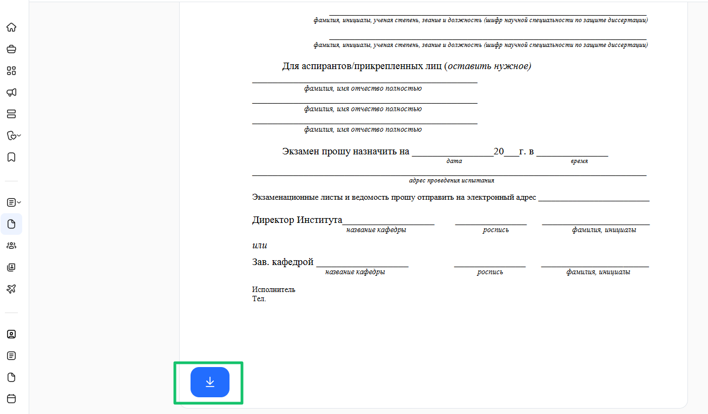

Для ознакомления можно скачать документ в списке внутренних документов компании, если такая возможность настроена для компании или аккаунта. Если настройка выключена, скачивание сотруднику недоступно.

Чтобы скачать корпоративный документ, выберите нужный документ из списка и нажмите кнопку скачивания. Кнопка расположена внизу страницы документа.

 

Для скачивания доступна только актуальная версия документа.