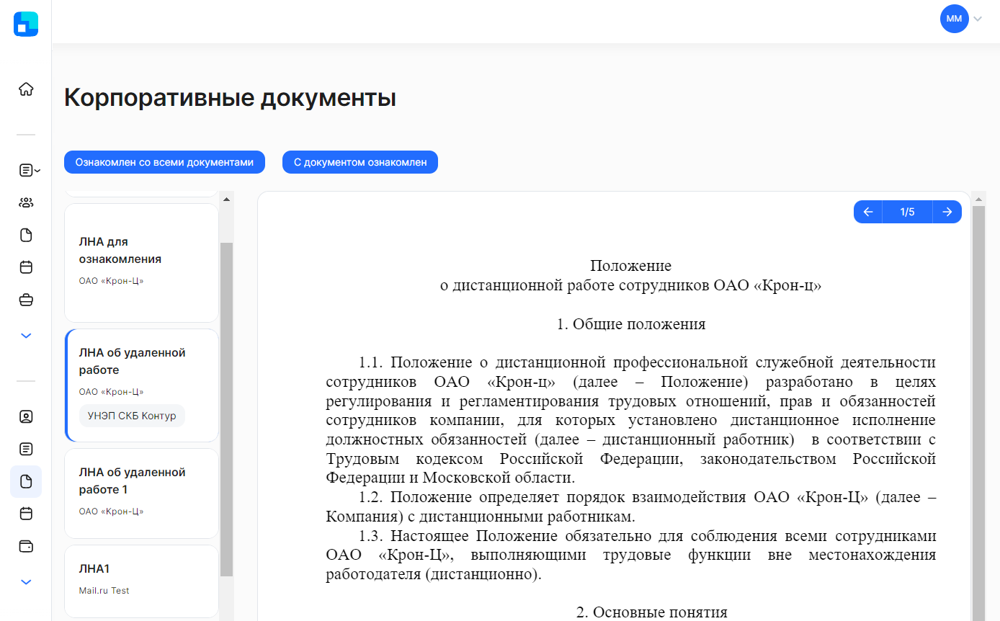

Для просмотра списка внутренних документов компании перейдите **Сервисы сотрудника** → **Корп. документы**.

Актуальная версия документа может быть доступна для просмотра и ознакомления всем сотрудникам компании, сотрудникам определённого подразделения или сотрудникам, занимаемым конкретные должности.

