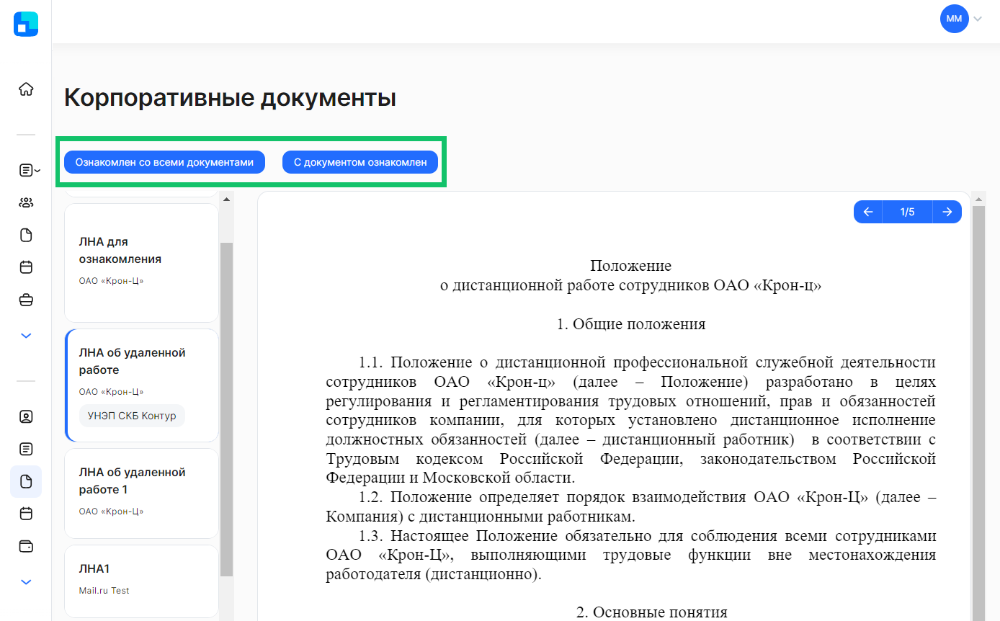
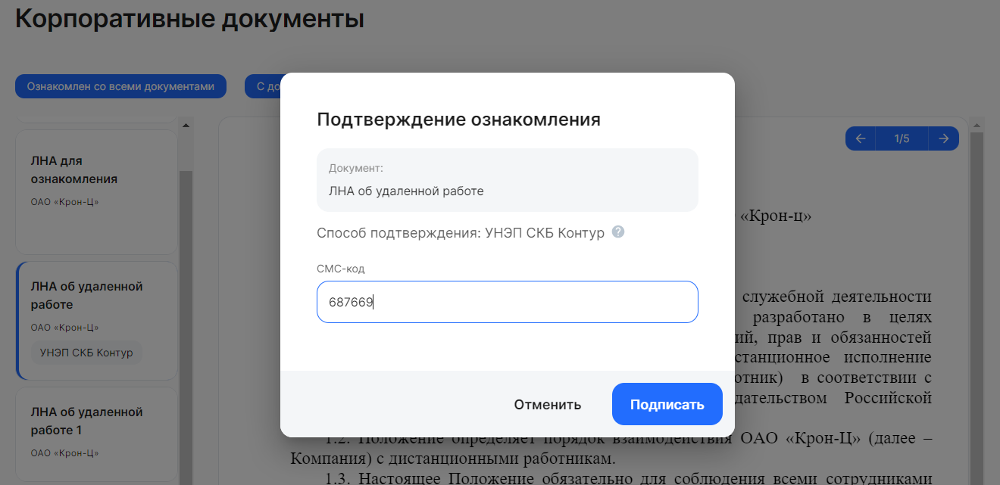

После ознакомления с документом в КЭДО сохраняются данные сотрудника, дата и время ознакомления.

Чтобы подписать все ЛНА и другие внутренние документы компании, нажмите кнопку **Ознакомлен со всеми документами**. 

Для подписания отдельного документа выберите необходимый документ из списка, изучите содержимое его страниц и нажмите кнопку **С документом ознакомлен**.

 

Подписывать документы можно простой электронной подписью (ПЭП) или усиленной неквалифицированной электронной подписью (УНЭП). Это зависит от того, какой тип подтверждения был выбран компанией на этапе создания документа.

Чтобы подписать документ УНЭП, из списка выберите документ с меткой «УНЭП СКБ Контур» и нажмите кнопку **С документом ознакомлен**.

Для подтверждения ознакомления с документом введите цифровой код из СМС от kontur и нажмите кнопку **Подписать**.

 

 

После подписания документ перейдёт в статус **Проверка подписи**. Обычно проверка подписи занимает несколько секунд.

<info>
После истечения срока ознакомления с версией ЛНА (когда версия становится прошлой), документ перестаёт быть доступным в Личном кабинете сотрудника.
</info>