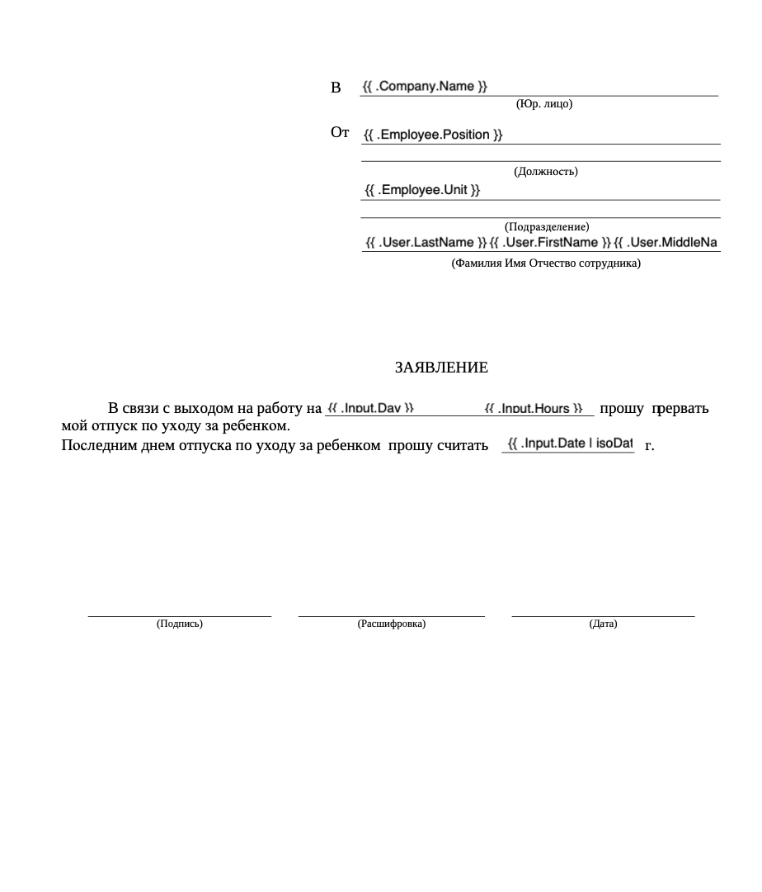
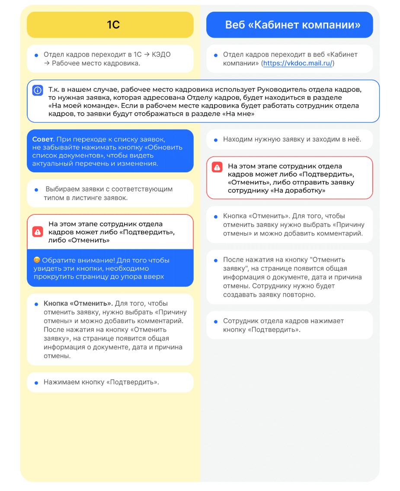

## Старт процесса

Чтобы подать заявление, Сотрудник:
1. Переходит в **Мои сервисы** веб-сервиса VK HR Tek, в раздел **Заявки**.
2. Нажимает кнопку **Создать заявку**.
3. Выбирает **Досрочный выход из отпуска по уходу за ребенком**.
4. Нажимает **Создать**.

## Этап 1. Формирование Сотрудником заявления

1. После нажатия кнопки **Создать заявку** сотрудник заполняет поле **Дата последнего дня отпуска по уходу за ребенком** и нажимает **Продолжить**.
3. На этом этапе сотрудник может **Отменить заявку**.
4. Здесь можно ознакомиться со сформированным заявлением (данные о сотруднике заполняются автоматически).
5. Если всё верно, Сотрудник нажимает кнопку **Продолжить**.

Шаблон заявления
 

## Этап 2. Подписание заявления Сотрудником

Сотрудник проверяет сформированный документ и нажимает кнопку **Подписать**. Тип подписи: ПЭП.

## Этап 3. Согласование заявления Руководителем
Если по какой-то причине у сотрудника нет руководителя, то процесс переходит сразу на следующий этап **Проверка заявления Отделом кадров**.

Руководитель переходит в **Сервисы компании веб-сервиса VK HR Tek**, в раздел **Заявки**.

На данном этапе Руководитель может либо **Подтвердить**, либо **Отменить заявку**.
В случае отмены заявки процесс стартует с первого этапа формирования заявления сотрудником.

## Этап 4. Проверка заявления Отделом кадров

Отдел кадров может согласовать (подтвердить) заявление, либо вернуть его на доработку сотруднику (на этап 1).

## Этап 5. Загрузка приказа Отделом кадров

Сотрудники отдела кадров могут обрабатывать заявки как в системе **1С**, так и в **Сервисах компании веб-сервиса VK HR Tek**.

### Работа через 1С

1. Специалист переходит в **Рабочее место кадровика**, в раздел **На моей команде** и открывает нужную заявку.
2. Приказ можно сформировать автоматически или загрузить вручную.

3. Для загрузки вручную нажимает на кнопку со скрепкой и загружает файл PDF.
4. Для автоматического создания документа нажимает **Создать документ**.
5. В открывшемся окне проверяет данные, выбирает причины нетрудоспособности и нажимает кнопку **Провести** → кнопку **КЭДО** → **Отправить в КЭДО**.

### Сервисы компании веб-сервиса VK HR Tek

1. Сотрудник Отдела кадров переходит в **Сервисы компании веб-сервиса VK HR Tek**, в раздел **Заявки**.
2. Открывает нужную заявку и нажимает кнопку **Подтвердить**.

На этом этапе отдел кадров может **Отменить заявку**.

3. Приказ загружается только вручную. Для этого специалист нажимает кнопку с изображением скрепки и загружает документ.

4. После загрузки документа нажимает кнопку **Продолжить**.

## Этап 6. Подписание документов Руководителем отдела кадров

Руководитель отдела кадров может подписывать заявки с помощью УКЭП как в системе **1С**, так и в **Сервисах компании веб-сервиса VK HR Tek**.

### Работа через 1С

Руководитель отдела кадров подписывает документ.

### Сервисы компании веб-сервиса VK HR Tek

Руководитель отдела кадров подписывает документ.

В открывшемся окне нажимает кнопку **Подписать**.

## Этап 7. Подписание документов Сотрудником

Сотрудник подписывает документы. Тип подписи: ПЭП.

## Этап 8. Проверка документов Отделом кадров

Сотрудники отдела кадров могут обрабатывать заявки как в системе **1С**, так и в **Сервисах компании веб-сервиса VK HR Tek**.

### Работа через 1С

Сотрудник отдела кадров открывает нужную заявку в **Рабочем месте кадровика** и нажимает кнопку **Подтвердить**.

### Работа через веб-сервис

Сотрудник отдела кадров открывает нужную заявку с этапом **Проверка** в **Сервисах компании → Заявки** и нажимает кнопку **Подтвердить**.

