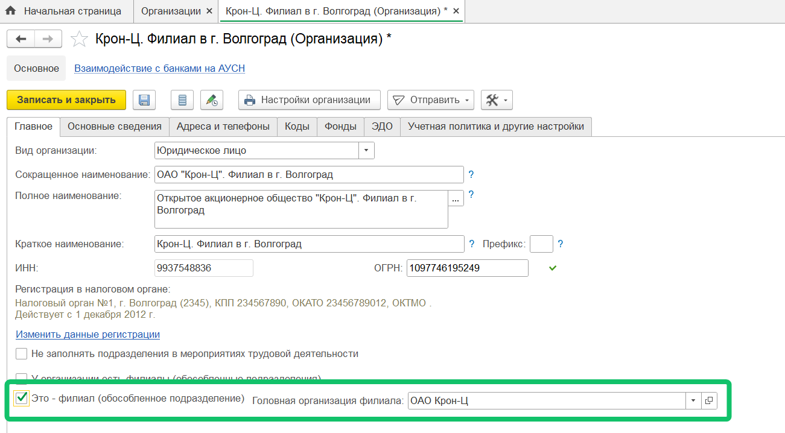
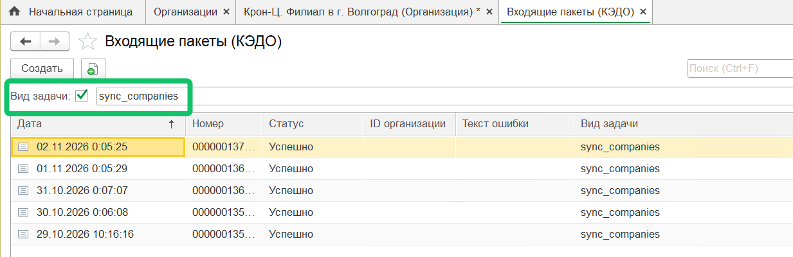
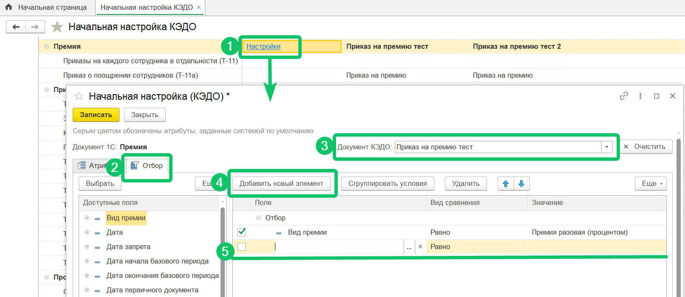
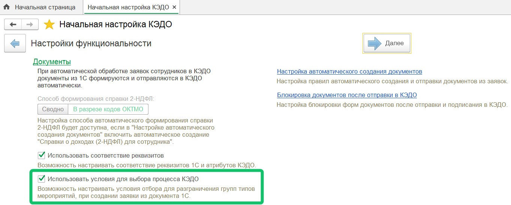
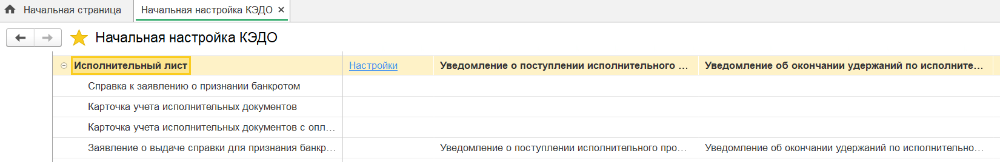
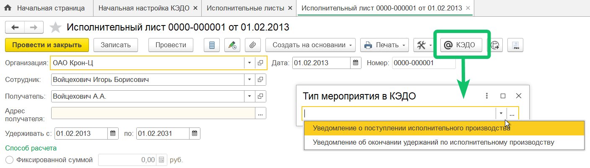
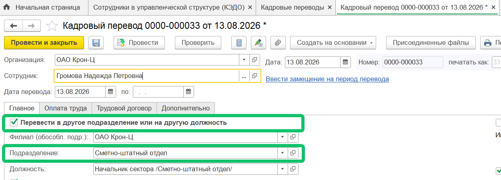
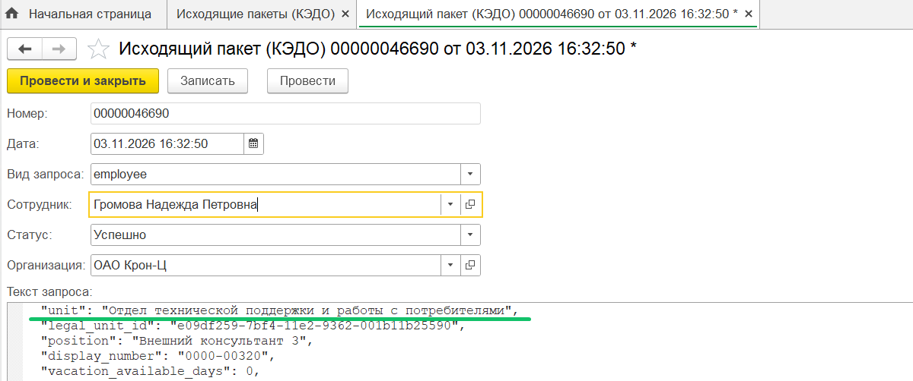

<info>
Новая версия расширения 1С КЭДО была протестирована на платформе 1С:Предприятие 8.5.1 с конфигурацией ЗУП КОРП, ред. 3.1.39.53
</info>

## **Тиражирование ЛНА на обособленные подразделения (филиалы) в рамках одного юрлица**

В сервисе VK HR Tek один корпоративный документ можно опубликовать сразу на несколько филиалов одного юридического лица, не создавая документ на каждый филиал отдельно.   

Для корректной работы данной функциональности в 1С добавили поддержку тиражирования корпоративных документов (ЛНА) на филиалы одного юрлица — из 1С в КЭДО передаются сведения о филиалах и их принадлежности к головной организации. 

Чтобы указать филиал для подключенного юрлица, необходимо:
1. Перейти в раздел **Организации**.   
2. Выбрать и открыть организацию из списка, которую хотите определить в качестве филиала.  
3. Активировать опцию **Это - филиал (обособленное подразделение)**.  
4. В поле **Головная организация филиала** выбрать наименование подключенного юрлица.  
5. Записать изменение.

Посмотреть интерфейс организации 

Чтобы проверить успешную передачу данных о юрлицах и их филиалах из 1С в КЭДО, перейдите в раздел **Входящие пакеты (КЭДО)** и найдите строки с видом задачи *sync_companies*. Задача на обмен данных выполняется один раз в сутки, после полуночи.   

Посмотреть интерфейс входящих пакетов

О том, как настроить публикацию ЛНА на филиалы в сервисе VK HR Tek, см. в [статье](/ru/release_notes/saas/20260800Core#korporativnye_dokumenty_lna).   

## **Условие для старта бизнес-процесса по реквизитам документа**

Новая возможность автоматизации отправки документа из 1С в КЭДО — система сама определяет бизнес-процесс по значению реквизита документа.  

Раньше маршрут выбирали вручную, и при большом потоке документов это требовало много времени на ручной труд.

В разделе **КЭДО → Начальная настройка → Соответствие документов** **→** ячейка **Настройки →** вкладка **Отбор** администратор задаёт условие: реквизит, вид сравнения и значение. Несколько реквизитов объединяются через «И»/«ИЛИ» (доступны типовые и кастомные реквизиты).  

Посмотреть интерфейс настройки

1. В разделе **Соответствие документов** нажмите кнопку **Настройки**.  
2. На форме настройки откройте вкладку **Отбор**.  
3. Выберите документ КЭДО, для которого хотите добавить условие.  
4. Добавьте строку для заполнения параметров условия.  
5. Из выпадающих списков выберите доступные поле, вид сравнения и значение.  
6. Запишите изменения.

Если условию соответствует несколько процессов, открывается окно выбора — как раньше, сопоставления без условия работают как прежде. 

Возможность управляется настройкой **Использование условий для выбора процесса КЭДО** (включена по умолчанию) в разделе **КЭДО → Начальная настройка → Настройка функциональности**.  

Посмотреть интерфейс настройки

## **Документ «Исполнительный лист»**

Добавили возможность отправлять документ «Исполнительный лист» из 1С в КЭДО по бизнес-процессам «Уведомление о поступлении исполнительного производства» и «Уведомление об окончании удержаний по исполнительному производству». Перед созданием заявки по кнопке **КЭДО** из документа 1С, проверьте, что настроено соответствие 1С документов и бизнес-процессов.  

Посмотреть интерфейс соответствия документов

Посмотреть интерфейс документа 1С

## **Отправка данных сотрудника при изменении места в управленческой структуре**

Добавили автоматическую повторную отправку данных сотрудника в КЭДО для случаев, когда было изменено место сотрудника в управленческой структуре, в том числе при обновлении управленческого подразделения после кадрового перевода. В среднем отправка данных может занимать до 5 минут.   

Для корректной работы функциональности проверьте, что для компании в КЭДО включена настройка импорта управленческой структуры из 1С, а также управленческая оргструктура создана в 1С и выгружена в КЭДО.   

Посмотреть интерфейс документа 1С

Чтобы проверить успешную передачу данных сотрудника из 1С в КЭДО, перейдите в раздел **Исходящие пакеты (КЭДО)**, откройте пакет сотрудника и найдите строку с полем *"unit"*.  

Посмотреть интерфейс исходящего пакета

## **Исправления**

Внесены общие улучшения производительности, удалены из регистра настроек подключения неиспользуемые поля и устранены ошибки в работе расширения 1С КЭДО.

