## **Бизнес-процессы**

Теперь администратор может собрать или изменить бизнес-процесс в визуальном конструкторе — без привлечения техподдержки. Раньше настройка процесса проходила только через обращение в техподдержку.  

В разделе **Типы заявок** администратор на холсте собирает маршрут: этапы и связи, параллельное согласование и подписание, развилки, исполнителей, атрибуты и дедлайны.  

<warn>

 Процессы, содержащие опции, которые пока не реализованы в конструкторе, остаются в старом интерфейсе и по-прежнему могут быть отредактированы через техподдержку. Конструктор будет обновляться в каждом следующем релизе — следите за новостями!

</warn>

Подробнее о возможностях нового конструктора читайте в [статье]().

Для тех, кто обратил внимание на этикетку BPMN.io на экране редактирования этапов — конструктор реализован полностью внутри нашего сервиса, но с использованием инструментов BPMN.io, поэтому по условиям лицензии мы обязаны добавить их товарный знак. 

Посмотреть интерфейс
 

Перейдите в раздел **Настройки** → **Бизнес-процессы** → **Типы заявок**. Откройте тип заявки с новыми возможностями редактирования — он обозначен шестеренкой.   
Если значка шестеренки у типа заявки нет — новый конструктор пока не используется, так как в процессе есть функционал, которого пока нет в конструкторе.   

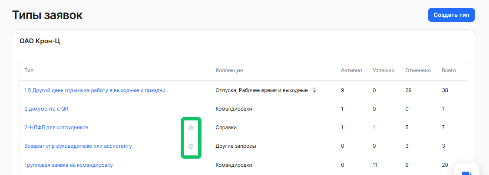

В блоке **Этапы заявки** нажмите кнопку **Редактировать**.   

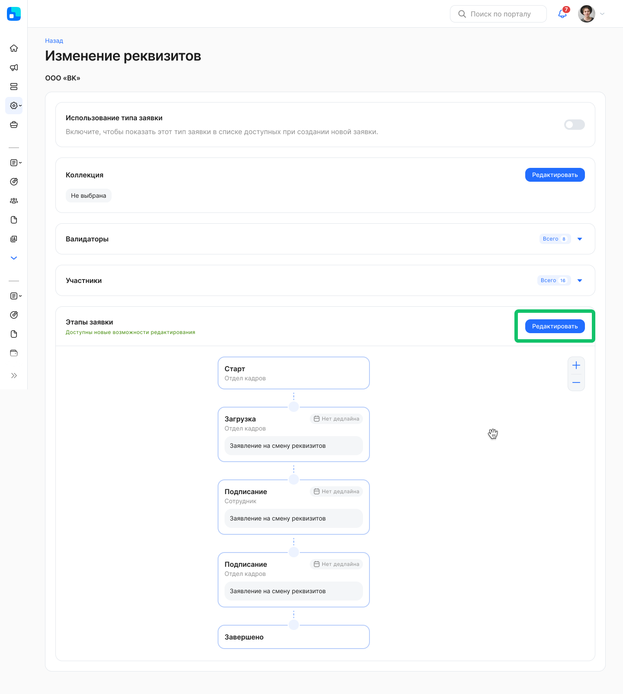

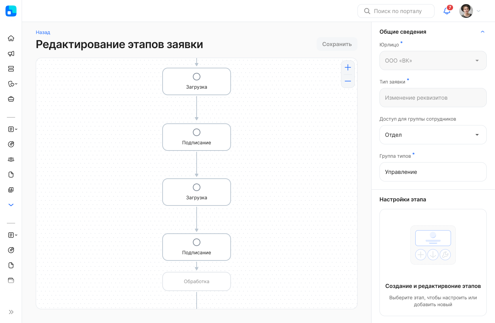

## **Корпоративные документы / ЛНА**

### **Тиражирование ЛНА на обособленные подразделения (филиалы) в рамках одного юрлица**

Один корпоративный документ можно опубликовать сразу на несколько филиалов одного юрлица, не создавая на каждый филиал отдельно.   

Важно:
* доработка распространяется на филиалы / обособленные подразделения, заведённые в 1С как отдельные юрлица;  
* в КЭДО такие филиалы отображаются отдельными компаниями, и в атрибуте «Юрлицо» при публикации ЛНА отражаются как отдельные юрлица;  
* функциональность будет доступна, если из 1С передается признак филиала.

Чтобы создать и опубликовать документ для филиалов, пользователь с группой в головной организации открывает раздел **Сервисы компании → Корп. документы** → кнопка **Новый документ** и выбирает вариант публикации **На филиалы**. Затем он выбирает головное юрлицо и не менее двух филиалов, заполняет настройки документа, загружает версию документа и публикует. Если филиал один, используется обычный сценарий «Юрлицо».

После публикации создаётся «родительский» документ и по одному «дочернему» на филиал, в статусе «Черновик». Пользователи с группой в филиалах получают уведомления о необходимости ознакомиться с документом.  

Специалист филиала открывает «дочерний» документ, ему доступен только выбор сотрудников (осуществляет вручную или загрузкой из файла) и публикует. 

В «родительском» документе можно добавить филиал, тогда для него создаётся черновик, или удалить его, если никто из сотрудников в этом филиале ранее не ознакомился с документом. В «родительском» документе число ознакомившихся сотрудников всегда будет равно 0.  

В листинге ЛНА будет установлен статус «Черновик» и доступен фильтр «Отображать родительские документы».

<warn>

Версии и настройки документа можно редактировать только в родительском документе, и они автоматически попадают во все дочерние, где эти атрибуты не доступны для редактирования. Настройки видимости для сотрудников задаются только в дочернем документе — у каждого филиала он свой.  

</warn>

Посмотреть интерфейс создания документа
 

Путь: раздел **Сервисы компании → Корп. документы** → кнопка **Новый документ**.  

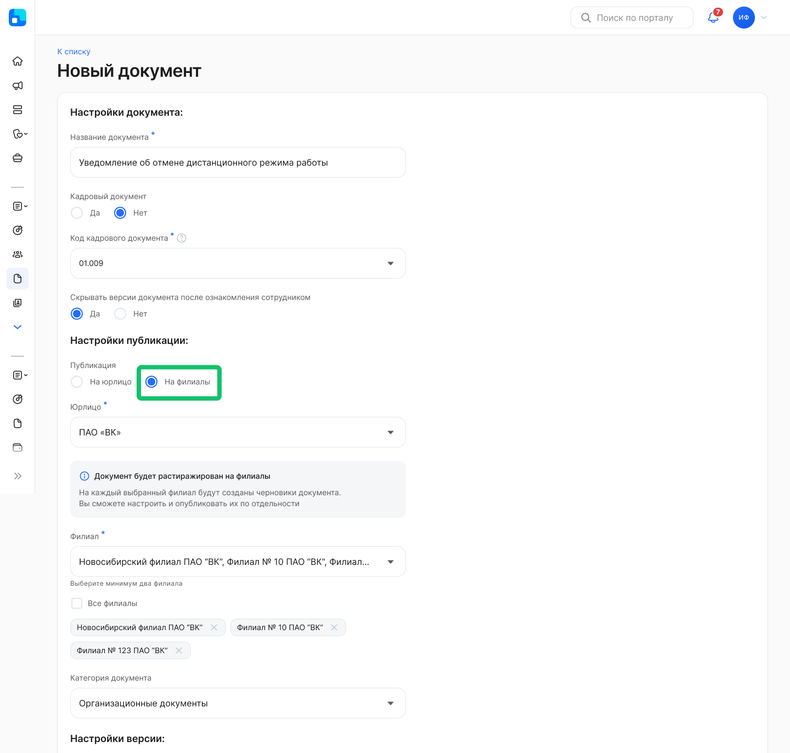

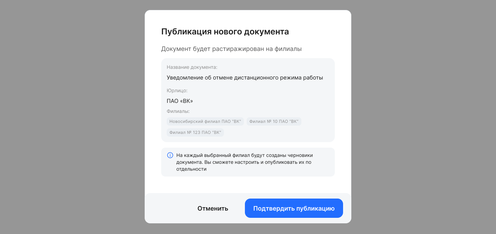

Посмотреть интерфейс листинга ЛНА
 
 
Путь: раздел **Сервисы компании → Корп. документы**.  

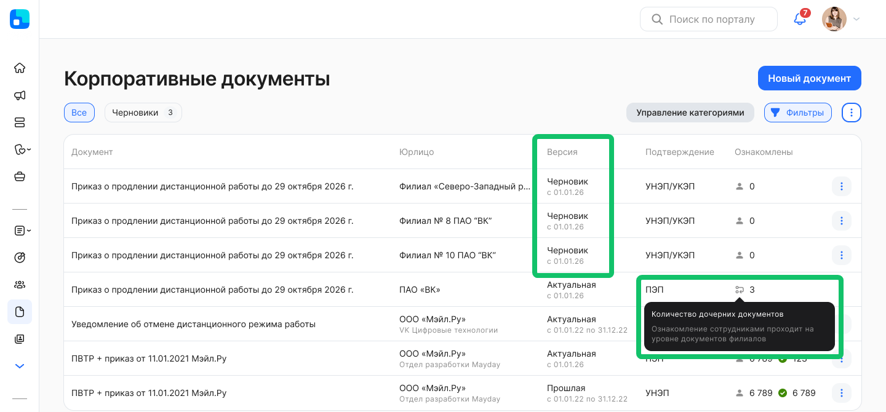

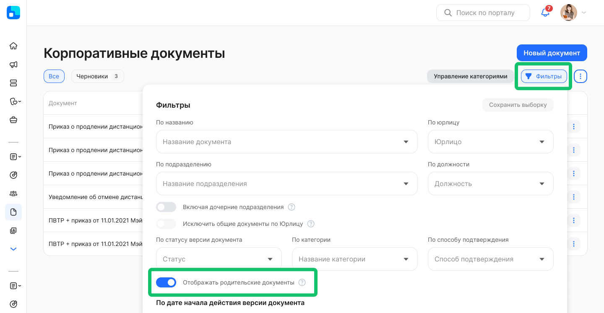

Посмотреть интерфейс документов
 

Родительский документ.  

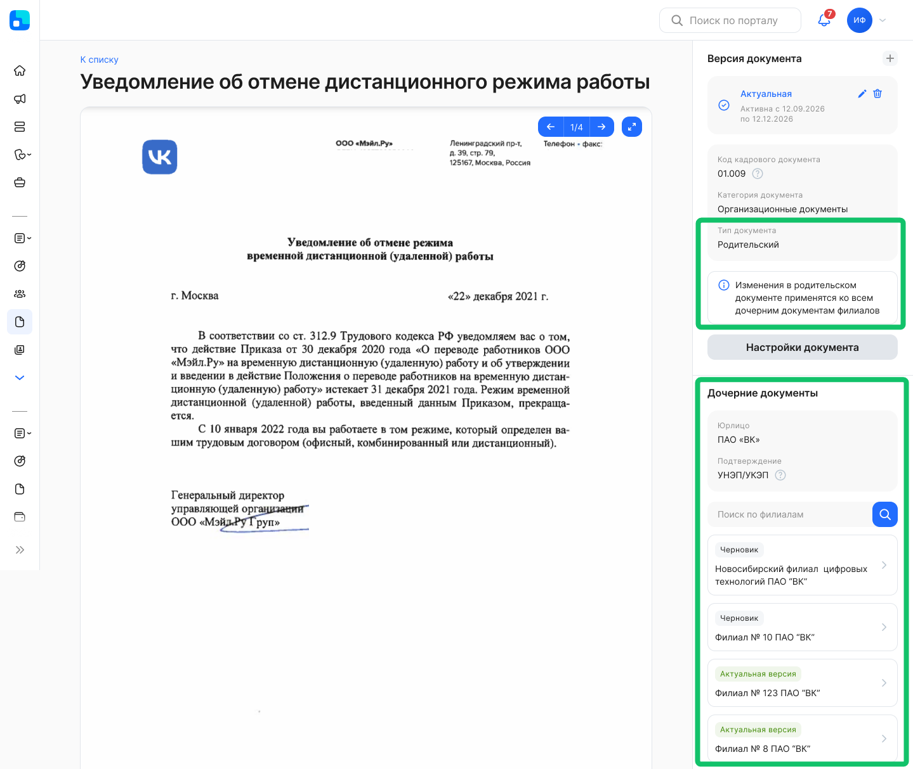

Дочерний документ для конкретного филиала.  

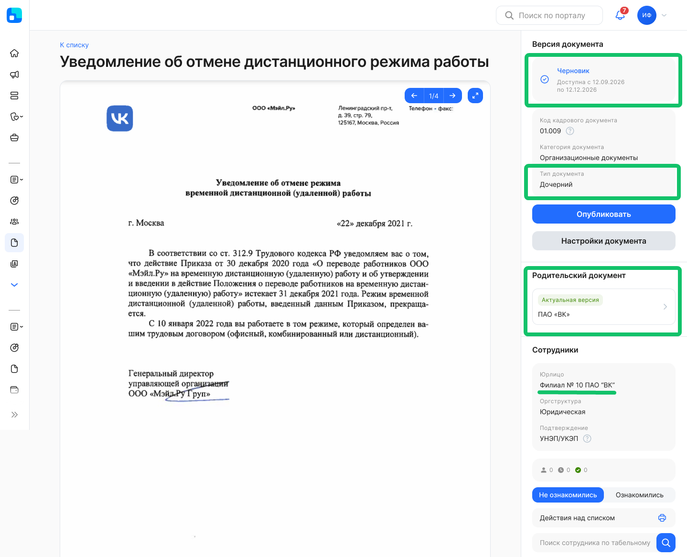

## **График отпусков**

### **Название к планированию графика отпусков**

Запущенные планирования графика отпусков (ПГО) теперь могут иметь названия, чтобы лучше их распознавать наряду со стандартным названием «График отпусков 2027»:
* каждому планированию можно дать своё название при его запуске в настройках самого планирования, например «Название Фабрики» или «Центральный офис»;  
* название будет отражаться в формате «График отпусков + год + Название», если название не задано (так как атрибут опциональный), остаётся стандартное название «График отпусков + год» (возможен такой сценарий, что название задается выборочно, некоторым планированиям дается название, некоторым — нет).

Что необходимо сделать:
* Пользователь с ролью «Менеджер графика отпусков» вводит название при создании планирования (**Настройки → Бизнес-процессы → Графики отпусков** → кнопка **Создать новое планирование**). Поле с названием необязательное, можно ввести до 70 символов, спецсимволы \<, \> и " запрещены.  
* Пока планирование активно, название доступно для редактирования через кнопку «Редактировать».  
* После запуска или редактирования планирования название видно в листинге ПГО, в листинге есть фильтр по названию с множественным выбором.  
* Сотрудник видит название в личном кабинете, в разделе **Графики отпусков** в сервисах сотрудника, согласующий — в сервисах компании (также при переключении между графиками в этом же разделе).  
* Руководитель или администратор видят название при назначении заместителя (**Настройки → Сотрудники и доступы → Заместители сотрудников**; **Профиль →** блок **Заместители**) и в разделе **Оргструктура** → редактирование подразделения → согласование по бизнес-процессам.

Посмотреть интерфейс создания планирования
 

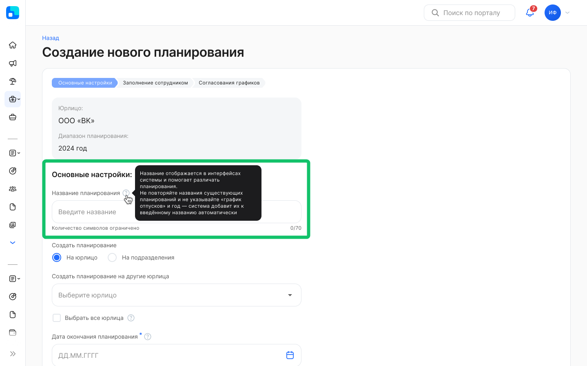

Посмотреть интерфейс поиска планирования
 

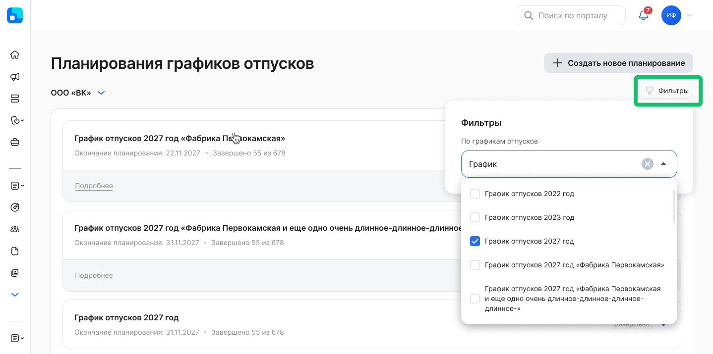

Посмотреть интерфейс назначения заместителя
 

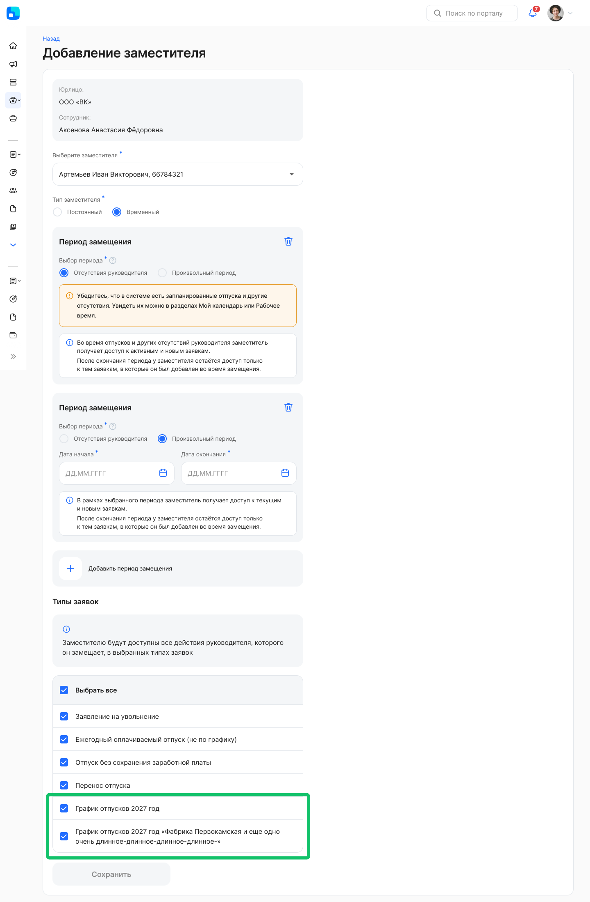

### **Процент запланированных отпусков по подразделению**

Согласующий увидит в разделе **Графики отпусков**, какая доля годовых отпусков в подразделении приходится на каждый месяц, а также визуализацию, где эта доля выше допустимого значения, заданного при запуске планирования. 

Процент рассчитывается как количество дней спланированных отпусков в целом по подразделению в конкретном месяце к количеству дней за весь год.  

Как это работает:
* Администратор включает или выключает доступность функциональности в настойках (**Настройки → Настройки общие → Настройки аккаунта** или **Настройки компании**), по умолчанию она будет включена. Настройка компании может отличаться от аккаунта, и тогда компания становится исключением.  
* Менеджер графика отпусков при создании планирования или при редактировании активного планирования задаёт пороговый процент для сравнения с рассчитанным: необязательное целое число, одно на всё планирование.  
* Руководитель, ассистент подразделения или специалист открывает **Сервисы компании → Графики отпусков**, переключается на просмотр по году и нажимает кнопку **Пересечения**. Под блоком **Динамика пересечений** он видит процент по месяцам для каждого подразделения:   
  * процент рассчитывается по мере направления заявки на согласование руководителю;  
  * процент перерассчитывается по мере направления всеми таких заявок и при возврате на доработку сотруднику от руководителя.  
* Если процент выше порога, заданного в планировании, рассчитанный процент выделяется цветом, а при наведении показывается подсказка с пороговым значением.  
* Если расчёт сделан не по всему подразделению, в подсказке это указано.  
* Также добавлена подсказка, если в подразделении не больше двух сотрудников.  
* Проценты отображаются при работе фильтра по подразделению, включая дочерние. При других фильтрах и в режиме месяца — проценты не отображаются.  
* Сотрудник не увидит процент и сравнение с пороговым значением, так как процент рассчитывается по подразделению в целом, не в разрезе ФИО, и функциональность доступна для сервиса компании.

Посмотреть интерфейс настройки
 

На уровне аккаунта. Путь: **Настройки** **→ Настройки общие → Настройки аккаунта →** блок **Бизнес-процессы →** настройка **Процент запланированных отпусков по подразделению**  

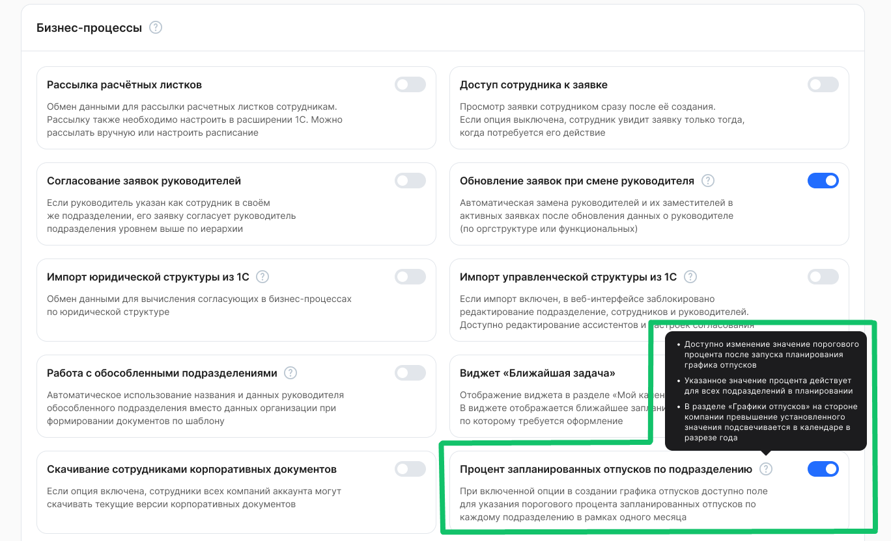

На уровне компании. Путь: **Настройки** **→ Настройки общие → Настройки компании →** настройка **Процент запланированных отпусков по подразделению**

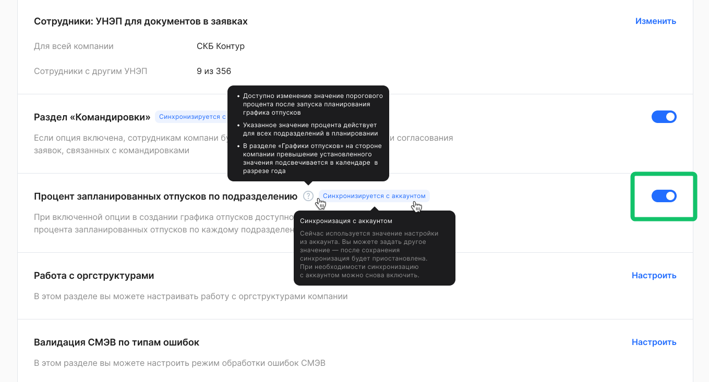

Посмотреть интерфейс создания и редактирования планирования

Создание планирования.  

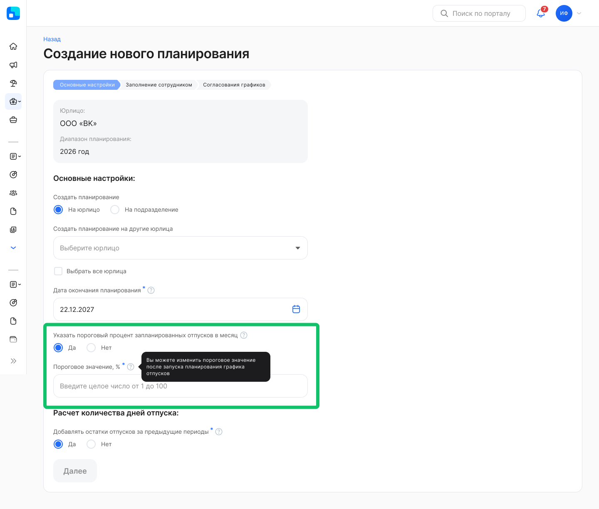

Редактирование графика отпусков.  

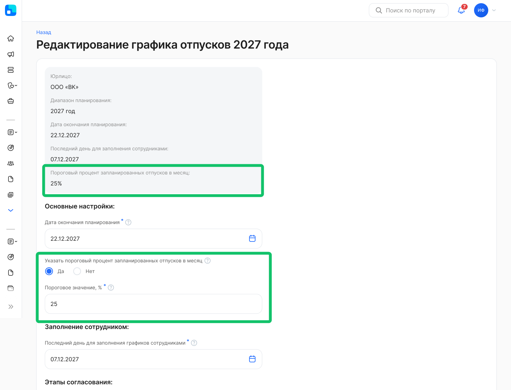

Посмотреть интерфейс планирования с включенной настройкой

Планирование в рамках одного года.  
Чтобы посмотреть превышение порогового значения по месяцам (ячейка выделена красным) и пересечения в рамках всех участвующих в планировании подразделений, нажмите кнопку **Пересечения**.  

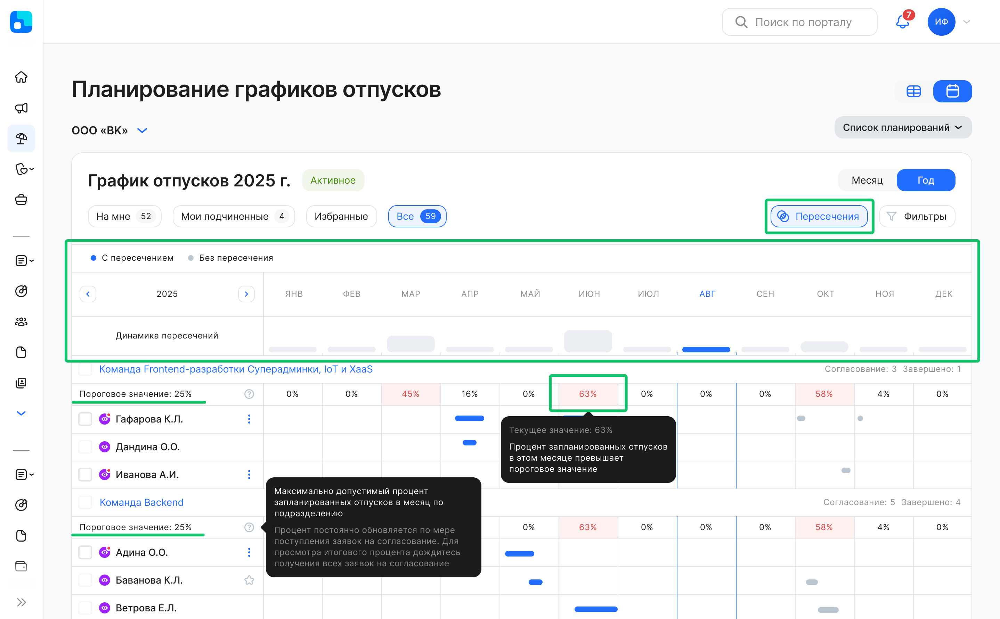

### **Выгрузка отчета с процентом запланированных отпусков по подразделению**

При включенной настройке по расчету процента запланированных отпусков по подразделению можно выгрузить отчет в Excel. С данным отчетом можно работать вне системы, и показывать его руководству.  

Если настройка по расчету процента спланированных отпусков для компании выключена, то кнопка скачивания отчета не отображается.  

Руководитель, ассистент подразделения, специалист или менеджер графика отпусков открывает **Сервисы компании → Графики отпусков**, выбирает юрлицо и планирование, нажимает кнопку **Пересечения** и скачивает файл .xlsx.   

В файле по каждому подразделению указаны процент по месяцам, дни запланированного отпуска по каждому сотруднику, общее количество календарных дней запланированных отпусков по подразделению и число таких сотрудников, которые запланировали эти дни, а также итоги за год. Процент выше порога выделен цветом в файле.  

Учитывается только фильтр по подразделению, включая дочерние. Остальные фильтры не применяются, даже если они выбраны, скачиваются все сотрудники по подразделению.  

Посмотреть интерфейс

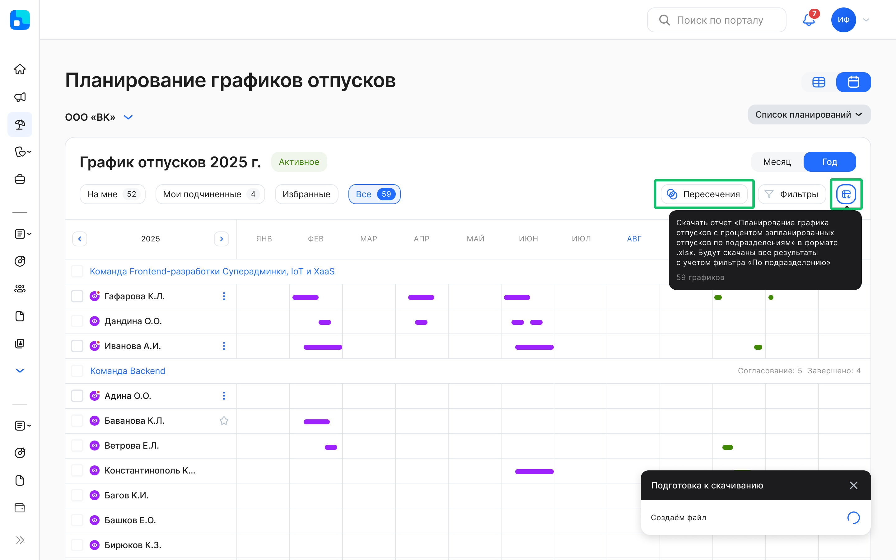

## **Командировки**

<info>

Функциональность доступна только в модуле «Командировки». Модуль приобретается дополнительно и платно, за подключением обратитесь к персональному менеджеру VK HR Tek

</info>

### **Поддержка внешней интеграции с несколькими сервисами бронирования**

Обновлены настройки модуля «Командировка» в части интеграции с внешними корпоративными платформами бронирования услуг по командировкам.  

Решение поддерживает подключение сразу нескольких провайдеров вместо одного. Доступные для настройки платформы — Trivio, Corteos, Smartway:
* подключаются как интеграции и привязываются к компании со своими параметрами подключения;  
* у одной компании может быть несколько интеграций разных типов, но не больше одной каждого типа, «ID компании у провайдера» уникален среди интеграций одного типа;
* после привязки интеграции к компании провайдер становится доступен для настройки в процессах этой компании: сотрудник не выбирает провайдера в заявке, процесс настраивается для каждого подключенного провайдера, сотрудник не выбирает и в заявке этот выбор не видит.

<warn>

Для существующих клиентов поведение интеграций со Smartway и Trivio не изменится

</warn>

<info>

Для настройки интеграции с внешними платформами бронирования обратитесь в [поддержку VK HR Tek](/ru/hr/support/contact_channels)

</info>